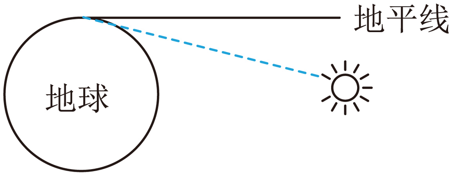

# Physics - 题目 2360

**ID**: 85728ceedeb34af39f118974bb2ce312
**年级**: Grade 8
**难度**: Easy
**题型**: Multiple-choice

## 题目
“大漠孤烟直，长河落日圆”是名句中的一句，给我们展现了一幅美丽的画卷。​​​​​​​‌其实诗人观察到的落日并非太阳的实际位置，这是因为太阳光经过不均匀的大气层发生了（      ）

## 解答

1. 太阳实际位置在地平线下面，当诗人观察到落日时，由于大气分布不均匀，落日发出的光在不均匀的大气层中发生了折射，折射光线不断向下偏折，我们逆着折射光线看去所看到的落日位置比实际位置高。故A符合题意，BCD不符合题意。

## 知识点

**中文**:
  - 光的折射现象

**English**:
  - Phenomenon of Refraction

---
