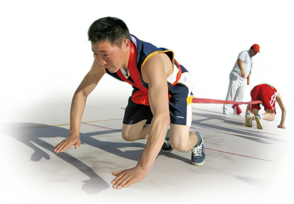

# Physics - 题目 2064

**ID**: 8861ac4032674133a323fa2e7d9593e4
**年级**: Grade 8
**难度**: Easy
**题型**: Multiple-choice

## 题目
押加是我国少数民族体育项目之一，又称为大象拔河。​​​​​​​‌如图比赛中，两个人现在处于僵持状态。则下列说法正确的是（      ）

## 解答

1. AB．在押加比赛中，两个人处于僵持状态，意味着他们的拉力达到了平衡。这表示左边运动员施加的拉力与右边运动员施加的拉力是相等的，因为他们是相互作用的，互为对方的反作用力，所以左右两边运动员给对方施加的力大小相等，故AB错误；
2. CD．在僵持状态下，运动员能够稳定地站在地面上，不被对方拉动，这是因为地面给他们提供了摩擦力，这个僵持状态即为平衡状态，他们各自受到的摩擦力与对方的拉力符合二力平衡的条件，是一对平衡力。因为拉力相等，所以两边运动员受到地面的摩擦力也是相等的。故C错误，D正确。

## 知识点

**中文**:
  - 二力平衡的条件及其应用
  - 力的作用是相互的
  - 静摩擦力的大小

**English**:
  - Conditions and Applications of Two-Force Equilibrium
  - Interaction of Forces
  - Magnitude of Static Friction

---
