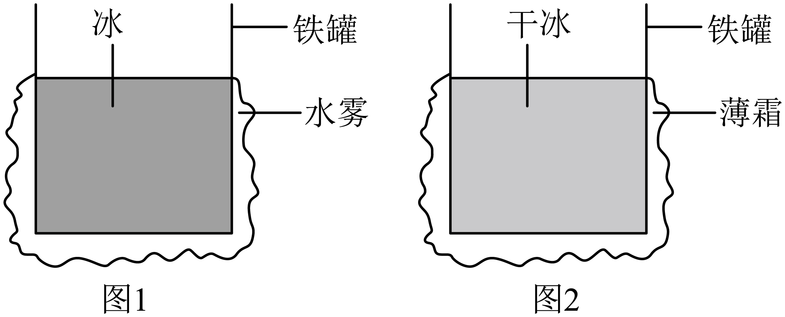

# Physics - 题目 2762

**ID**: 98d0da5df5804e6a9e14cdfbb4229847
**年级**: Grade 8
**难度**: Easy
**题型**: Multiple-choice

## 题目
恒温25℃的室内，把冰粒、干冰颗粒（固态二氧化碳）分别装在两个干燥的铁罐里，观察发现，装冰的罐子外壁结了一层水雾，铁罐里冰粒变小，冰粒周围有液体，如图1所示；装干冰的罐子外壁结了一层薄薄的霜，铁罐里干冰颗粒变小，没有液体痕迹，如图2所示。​​​​​​​‌以下说法正确的是（      ）

## 解答

1. A．物质由气态变成液态的过程叫液化，所以，图1罐子外壁的水雾由空气中的水蒸气遇到冷的罐壁液化而成，故A正确；
2. B．物质由固态变成液态的过程叫熔化，图1罐里冰粒周围的液体主要由冰粒熔化形成的，故B错误；
3. C．物质由气体直接变为固体的过程是凝华，所以，图2罐子外壁的薄霜主要由空气中的水蒸气凝华而成，故C错误；
4. D．图2罐里干冰颗粒变小主要原因是干冰颗粒升华变成二氧化碳气体，而不是水蒸气，故D错误。

## 知识点

**中文**:
  - 液化及液化放热的特点
  - 熔化与熔化吸热的特点
  - 生活中的升华现象
  - 生活中的凝华现象

**English**:
  - Liquefaction and Heat Release
  - Melting and Heat Absorption
  - Sublimation Phenomena in Life
  - Deposition Phenomena in Life

---
