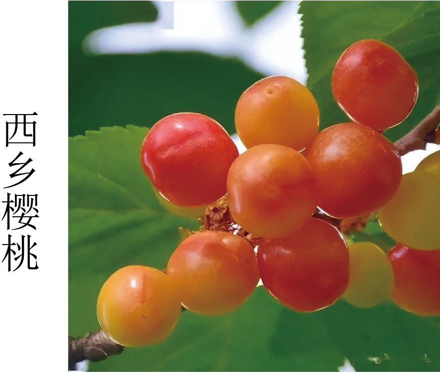

# Physics - 题目 840

**ID**: 9dc77631a76d40a68a279989ad9cc09d
**年级**: Grade 8
**难度**: Easy
**题型**: Multiple-choice

## 题目
樱桃是陕西省西乡县地标性的水果代表。​​​​​​​‌下列数据中与一颗“西乡大樱桃”的质量最接近的是（      ）

## 解答

1. 与鸡蛋对比，一个鸡蛋质量约50g，一颗樱桃质量小于一个鸡蛋质量，一颗樱桃质量约10g，1mg太小，100g、1000g太大，故B符合题意，A、C、D不符合题意。

## 知识点

**中文**:
  - 长度的估测

**English**:
  - Estimation of Length

---
