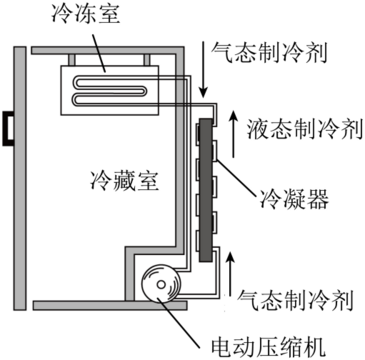

# Physics - 题目 1074

**ID**: a634495cc396430db55655b0855206bf
**年级**: Grade 8
**难度**: Easy
**题型**: Multiple-choice

## 题目
如图所示是电冰箱的构造和工作原理图，下列有关说法正确的是（      ）​​​​​​​‌

## 解答

1. ACD．压缩机将气态制冷剂压入冷凝器里，气态变为了液体，是液化放热，故ACD错误；
2. B．液态制冷剂进入冰箱冷冻室里，从液态变为气态，是汽化吸热，故B正确。

## 知识点

**中文**:
  - 汽化及汽化吸热的特点
  - 液化及液化放热的特点

**English**:
  - Vaporization and Heat Absorption
  - Liquefaction and Heat Release

---
