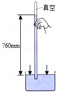

# Physics - 题目 554

**ID**: a7d7baa0035048f09aa8c08e02afa36f
**年级**: Grade 8
**难度**: Easy
**题型**: 选择题（本大题有14小题，每小题2分，共28分。每小题只有一个选项正确）

## 题目
如图所示的托里拆利实验中，若将玻璃管由竖直变成倾斜时，则（      ）A．测得大气压值偏大B．槽内水银面的位置不变C．管内液柱的高度变大，长度变大D．管内液柱的高度不变，长度变大​​​​​​​‌

## 解答

1. 在托里拆利实验中，水银柱的高度是指管内水银面到水银槽中水银面的竖直高度，这一高度的大小是由外界大气压决定的，外界大气压不变，则水银柱的高度不变，所测量的大气压的竖直不变；倾斜后为了保证原来的高度，水银柱的长度就会相应变长，则槽内水银面的位置会下降；故ABC错误，D正确。

## 知识点

**中文**:
  - 大气压强的测量及标准大气压

**English**:
  - Measurement of Atmospheric Pressure & Standard ATM

---
