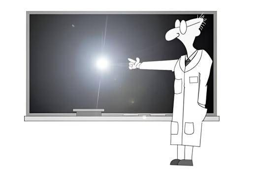

# Physics - 题目 1105

**ID**: b1d97cace08e4fbdb3e9c2d8feb6597e
**年级**: Grade 8
**难度**: Easy
**题型**: Multiple-choice

## 题目
在教室中上课，有时黑板反射的光会“晃”着一些同学的眼睛，看不清黑板上的粉笔字。​​​​​​​‌出现这种现象的原因是（      ）

## 解答

1. 黑板反光是因为黑板较光滑，发生镜面反射，进入眼睛的反射光线较强，而字发生漫反射进入眼睛的反射光线较弱，所以黑板反射的光会“晃”着一些同学的眼睛，不论是镜面反射还是漫反射都遵循光的反射定律。

## 知识点

**中文**:
  - 光的反射定律及其应用
  - 镜面反射和漫反射

**English**:
  - Law of Reflection and Applications
  - Specular and Diffuse Reflection

---
