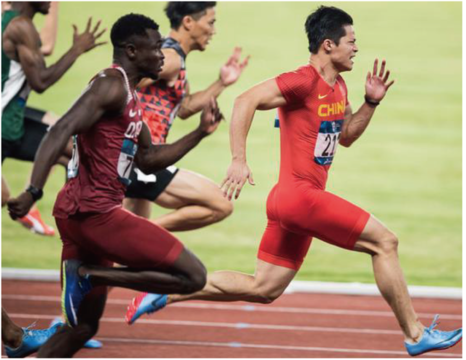

# Physics - 题目 1297

**ID**: c30019800cbd40bba9743c1ab5e98004
**年级**: Grade 8
**难度**: Easy
**题型**: Multiple-choice

## 题目
如图示，在2020年东京奥运会田径比赛男子百米半决赛中，我国运动员苏炳添跑出了9秒83的好成绩，获得半决赛第一，并且打破亚洲纪录，一举创造历史——他成为第一位跑进奥运会男子百米决赛的中国选手，圆了无数中国田径迷的梦想。​​​​​​​‌他在3s时的速度为8.0m/s，到达终点时的速度为10.8m/s，则他在全程内的平均速度大约是（      ）

## 解答

1. 全程的路程为s=100m，全程所用的时间为t=9.83s，所以全程的平均速度为
2. $v=\frac {s}{t}=\frac {100{\rm{m}}}{9.83{\rm{s}}}=10.2{\rm{m}}{\rm{/}}{\rm{s}}$
3. 故ABD不符合题意，C符合题意。
4. 故选C。

## 知识点

**中文**:
  - 平均速度及其计算

**English**:
  - Average Velocity and Calculation

---
