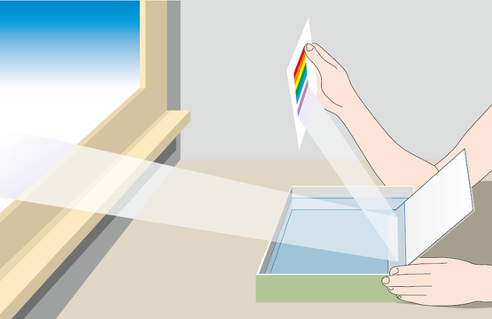

# Physics - 题目 1933

**ID**: d3701edc760e44f9ab84fc941f41175d
**年级**: Grade 8
**难度**: Easy
**题型**: Multiple-choice

## 题目
如图所示，在深盘中盛一些水，盘边斜放一个平面镜，使平面镜的下部浸入水中，让一束阳光照射在水下的平面镜上，并反射到白纸上，可在白纸上看到七彩光带。​​​​​​​‌下列有关说法正确的是（      ）

## 解答

1. A．如图所示的装置相当于三棱镜，太阳光经过三棱镜被分解为绚丽的七色光，属于光的色散现象，彩虹是光的色散形成的，该现象与彩虹的形成原理相同，故A错误；
2. B．在彩色光带外侧有看不见的光，有红外线和紫外线，故B错误；
3. C．太阳光经过三棱镜被分解为绚丽的七色光，因此在白纸上看到红、橙、黄、绿、蓝、靛、紫的彩色光带，说明白光是由各种色光混合而成的，故C正确；
4. D．光在不同介质中传播速度不同，光在水中和空气中的传播速度不同，故D错误。

## 知识点

**中文**:
  - 光的传播速度与光年
  - 光的色散原理及现象
  - 色光的三原色和颜料的三原色
  - 红外线的特点及应用
  - 紫外线的特点及应用

**English**:
  - Speed of Light and Light Years
  - Principle and Phenomenon of Dispersion
  - Three Primary Colors of Light and Pigments
  - Characteristics and Applications of Infrared
  - Characteristics and Applications of Ultraviolet

---
