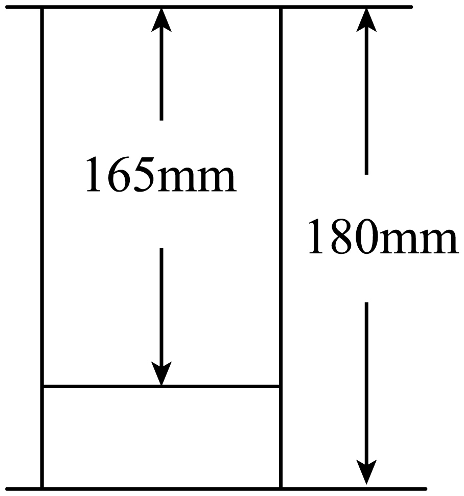

# Physics - 题目 326

**ID**: d90739e74c3e4ee7add6ce8c2f019d54
**年级**: Grade 8
**难度**: Easy
**题型**: Multiple-choice

## 题目
降雪量是用一定面积的雪化成水后的高度来衡量的。​​​​​​​‌一场大雪后，小明用刻度尺测出水平地面上雪的厚度为180mm，再用铁板将雪夯实，测出夯实雪坑的深度为165mm，已知 $ρ{{}_{水}}=1.0\times 10{^{3}}{\rm{k}}{\rm{g}}{\rm{/}}{\rm{m}}{^{{{3}}}}$ ， $ρ{{}_{冰}}=0.9\times 10{^{3}}{\rm{k}}{\rm{g}}{\rm{/}}{\rm{m}}{^{{{3}}}}$ ，这场大雪的降雪量约为（      ）

## 解答

1. 因为降雪量是用一定面积的雪化成水后的高度来衡量的，刚降下的雪非常松软，里面的空隙较大，踏实后，雪坑的深度为165mm，说明踏实后雪的实际高度为180mm-165mm=15mm，此时，雪的密度等于冰的密度，为水密度0.9倍，故化成水后为15mm×0.9=13.5mm，故这场大雪的降雪量约为13.5mm。

## 知识点

**中文**:
  - 密度公式的应用

**English**:
  - Application of Density Formula

---
