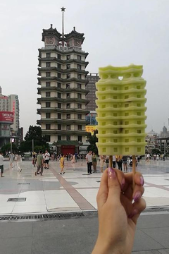

# Physics - 题目 127

**ID**: e46cc03442fe4d3dac146c736f8b4cdc
**年级**: Grade 8
**难度**: Easy
**题型**: Multiple-choice

## 题目
郑州“二七塔”雪糕赢得了大家的一致喜爱。​​​​​​​‌小明同学也买了一只尝尝，他打开包装后，发现雪糕“冒”出了“白气”。下列说法正确的是（      ）

## 解答

1. A．雪糕上出现一层“白霜”是水蒸气遇冷凝华形成的小冰晶，故A错误；
2. BC．雪糕“冒”出了“白气”，“白气”其实是空气中热的水蒸气遇到冷的雪糕液化形成的小水珠，液化放热，故BC错误；
3. D．吃雪糕时感觉很凉是因为雪糕自身温度很低，而且雪糕在体内熔化时也会从人体吸热，故D正确。

## 知识点

**中文**:
  - 液化及液化放热的特点
  - 熔化与熔化吸热的特点
  - 生活中的凝华现象

**English**:
  - Liquefaction and Heat Release
  - Melting and Heat Absorption
  - Deposition Phenomena in Life

---
