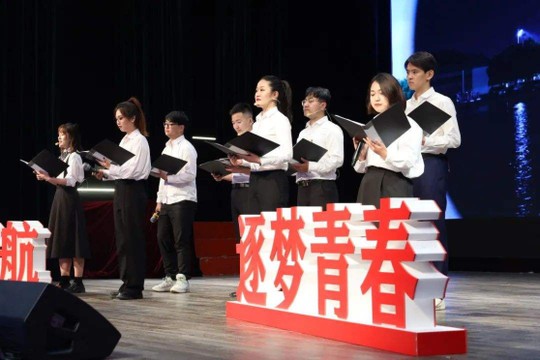

# Physics - 题目 1925

**ID**: e47c831473bf47f3acb632dbbc3e4da9
**年级**: Grade 8
**难度**: Easy
**题型**: Multiple-choice

## 题目
为庆祝中国共产党建党100周年与响应“双减”号召，学校举行了《青春·成长》诗歌朗诵大赛，以下四个选项中解择不正确的是（      ）​​​​​​​‌

## 解答

1. A．声音是由物体的振动产生的，朗诵者的声音是出其声带振动产生的，故A正确，不符合题意；
2. B．声音的传播需要介质，歌声是通过空气传到现场观众耳中的，故B正确，不符合题意；
3. C．主持人使用话筒是为了提高声音的响度，故C错误，符合题意；
4. D．防止噪声污染可以从噪声的产生、噪声的传播及噪声的接收这三个环节进行防止，禁止观众在礼堂中大声说话是在声源处减弱噪声，故D正确，不符合题意。

## 知识点

**中文**:
  - 响度
  - 声音的产生和声源
  - 防治噪声的途径
  - 声音的传播途径

**English**:
  - Loudness
  - Sound Production and Sound Sources
  - Methods of Noise Control
  - Pathways of Sound Propagation

---
