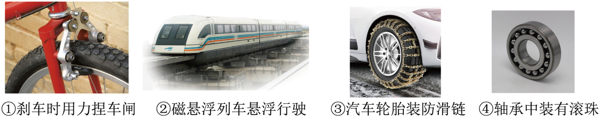

# Physics - 题目 2764

**ID**: f80b3c93b8014efc8ca78dcf3704a51b
**年级**: Grade 8
**难度**: Easy
**题型**: Multiple-choice

## 题目
下图四个实例中，目的是为了增大摩擦的是（      ）​​​​​​​‌

## 解答

1. ①刹车时用力捏车闸，是在接触面的粗糙程度一定时，通过增大压力来增大摩擦力；
2. ②磁悬浮列车悬浮行驶，是通过使接触面脱离来减小摩擦力；
3. ③汽车轮船装防滑链，是在压力一定时，通过增大接触面的粗糙程度来增大摩擦力；
4. ④轴承中装有滚珠，是用滚动代替滑动来减小摩擦。
5. 综上所述，目的是为了增大摩擦的是①③，故C符合题意，ABD不符合题意。
6. 故选C。

## 知识点

**中文**:
  - 影响滑动摩擦力大小因素的探究实验

**English**:
  - Experiment: Factors Affecting Sliding Friction

---
