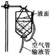

# Physics - 题目 1667

**ID**: 96ad651eb87b4a7c9a968ec73c6cf397
**年级**: Grade 8
**难度**: Easy
**题型**: Multiple-select

## 题目
如图是医生为了给患者输液，用网兜把药瓶倒挂在支架上，瓶口插有输液管和空气管。​​​​​​​‌输液过程中，下列说法正确的（      ）

## 解答

1. A．血液回流到输液管中说明药液压强小药瓶升高可以增大压强，故A正确；
2. B．因为液体压强随深度的减小而减小，所以瓶内药液深度减小对瓶盖的压强越来越小；故B错误；
3. C．瓶内上方气体的压强与瓶内药液压强之和等于大气压强，药液压强减小，瓶内上方气体的压强应变大，故C错误；
4. D．空气管中的空气与药液接触处的压强应等于大气压，故D正确。
5. 故选AD。

## 知识点

**中文**:
  - 增大及减小压强的方法与应用
  - 液体压强的特点及应用
  - 大气压的应用

**English**:
  - Methods and Applications of Increasing/Decreasing Pressure
  - Characteristics and Applications of Liquid Pressure
  - Applications of Atmospheric Pressure

---
