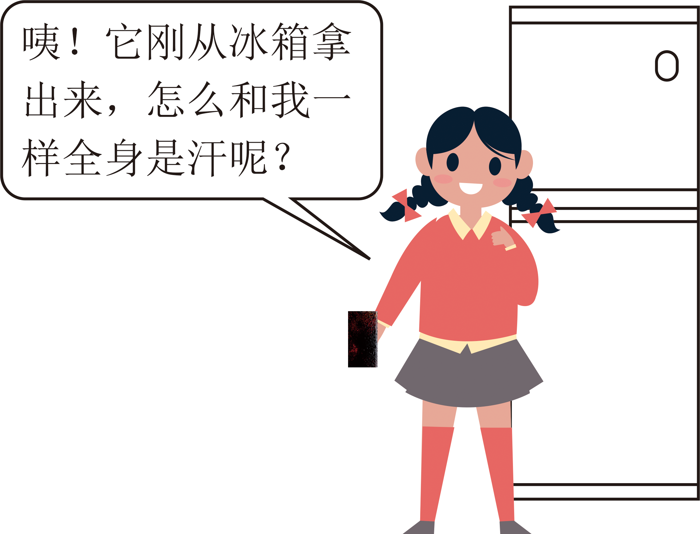

# Physics - 题目 939

**ID**: 82eac66c09e74fdab0859db3589d7447
**年级**: Grade 8
**难度**: Easy
**题型**: Short Answer

## 题目
为延长茶叶的保质期，人们常将茶叶包装好后放入冰箱中，用低温的方法贮存茶叶，这样可将茶叶的保质期延长（可达2年之多）。​​​​​​​‌肖敏家来客人了，当她从冰箱里拿出茶叶包装盒时，出现了如图的一幕。试回答：请解释图中小朋友提出的问题。

## 解答

1. 茶叶包装盒的温度比空气的温度低，空气中的水蒸气遇到冷的盒壁液化而形成了小水珠。

## 知识点

**中文**:
  - 液化及液化放热的特点

**English**:
  - Liquefaction and Heat Release

---
