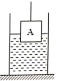

# Physics - 题目 1107

**ID**: 1f660b3863104e2f8e78f27b0021390c
**年级**: Grade 8
**难度**: Hard
**题型**: Calculation

## 题目
如图所示底面积为 $200{\rm{c}}{\rm{m}}{^{2}}$ 、重为 $10{\rm{N}}$ 、足够高的薄壁柱形容器，内装有 $0.3{\rm{m}}$ 深的水，静止置于水平桌面上。​​​​​​​‌用细线吊着质量为 $3{\rm{k}}{\rm{g}}$ 、边长为 $0.1{\rm{m}}$ 的实心正方体 ${\rm A}$ ，使其一半体积浸入水中静止，求：（1）没有放入A时，容器内水对底部的压强；（2）A受到的浮力；（3）若剪断细线，待稳定后，则容器对水平桌面的压强。

## 解答

1. 解：（1）没有放入A时，水的深度 $h=0.3{\rm{m}}$ ，则容器内水对底部的压强
2. $p=ρ{{}_{水}}gh=1\times 10{^{3}}{\rm{k}}{\rm{g}}/{\rm{m}}{^{3}}\times 10{\rm{N}}/{\rm{k}}{\rm{g}}\times 0.3{\rm{m}}=3\times 10{^{3}}{\rm{P}}{\rm{a}}$
3. （2）当正方体一半体积浸入水中时，排开水的体积
4. $V{{}_{排}}=\frac {1}{2}V{{}_{{\rm{A}}}}=\frac {1}{2}{\left({h{{}_{{\rm{A}}}}}\right)^{3}}=\frac {1}{2}\times {\left({0.1{\rm{m}}}\right)^{3}}=5\times 10{^{-4}}{\rm{m}}{^{3}}$
5. 正方体受到水的浮力
6. $F{{}_{浮}}=G{{}_{排}}=ρ{{}_{水}}V{{}_{排}}g=1\times 10{^{3}}{\rm{k}}{\rm{g}}/{\rm{m}}{^{3}}\times 5\times 10{^{-4}}{\rm{m}}{^{3}}\times 10{\rm{N}}/{\rm{k}}{\rm{g}}=5{\rm{N}}$
7. （3）容器的底面积
8. $S{{}_{容}}=200{\rm{c}}{\rm{m}}{^{2}}=2\times 10{^{-2}}{\rm{m}}{^{2}}$
9. 容器内水的体积
10. $V{{}_{水}}=S{{}_{容}}h=2\times 10{^{-2}}{\rm{m}}{^{2}}\times 0.3{\rm{m}}=6\times 10{^{-3}}{\rm{m}}{^{3}}$
11. 水的重力
12. $G{{}_{水}}=m{{}_{水}}g=ρ{{}_{水}}gV{{}_{水}}=1\times 10{^{3}}{\rm{k}}{\rm{g}}/{\rm{m}}{^{3}}\times 10{\rm{N}}/{\rm{k}}{\rm{g}}\times 6\times 10{^{-3}}{\rm{m}}{^{3}}=60{\rm{N}}$
13. 物体 ${\rm{A}}$ 的重力
14. $G{{}_{{\rm{A}}}}=m{{}_{{\rm{A}}}}g=3{\rm{k}}{\rm{g}}\mathrm{×}10{\rm{N}}/{\rm{k}}{\rm{g}}=30{\rm{N}}$
15. 则剪断细线，待稳定后，容器对桌面的压力
16. $F=G{{}_{杯}}+G{{}_{水}}+G{{}_{{\rm{A}}}}=10{\rm{N}}+60{\rm{N}}+30{\rm{N}}=100{\rm{N}}$
17. 受力面积
18. $S{{}_{容}}=2\times 10{^{-2}}{\rm{m}}{^{2}}$
19. 则容器对桌面的压强为
20. $p=\frac {F}{S{{}_{容}}}=\frac {100{\rm{N}}}{2\times 10{^{-2}}{\rm{m}}{^{2}}}=5\times 10{^{3}}{\rm{P}}{\rm{a}}$
21. 答：（1）没有放入 ${\rm A}$ 时，容器内水对底部的压强 $3\times 10{^{3}}{\rm{P}}{\rm{a}}$ ；
22. （2） ${\rm A}$ 受到的浮力 $5{\rm{N}}$ ；
23. （3）若剪断细线，待稳定后，则容器对水平桌面的压强 $5\times 10{^{3}}{\rm{P}}{\rm{a}}$ 。

## 知识点

**中文**:
  - 压强的计算
  - 液体压强的大小及其计算
  - 浮力大小的计算
  - 密度、压强和浮力的综合

**English**:
  - Calculation of Pressure
  - Magnitude and Calculation of Liquid Pressure
  - Calculation of Buoyancy
  - Integrated Density, Pressure, and Buoyancy

---
