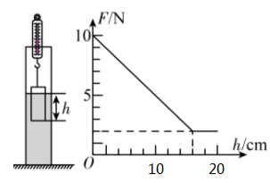

# Physics - 题目 1939

**ID**: 3d9aff3ae754469abc666700fd0a389d
**年级**: Grade 8
**难度**: Hard
**题型**: Calculation

## 题目
在水平桌面上放置一个底面积为100cm^{2}，质量为400g的圆筒，筒内装有16cm深的某种液体。​​​​​​​‌弹簧测力计的下端悬挂着一个底面积为50cm^{2}，高为16cm的金属柱，当金属柱从液面上方逐渐浸入液体中直到全部浸没时，弹簧测力计的示数F与金属柱浸入液体深度h的关系如图所示。（圆筒厚度忽略不计，筒内液体没有溢出，g取10N/kg）。求：（1）金属柱浸没在液体中受到的浮力；（2）圆筒内所装液体的密度；（3）金属柱浸没时，液体对容器底的压强比未放入金属柱前增加了多少？（4）当金属柱浸没在液体中时，圆筒对桌面的压强。

## 解答

1. 解：（1）由图象可知：当h=0cm时，金属柱的重力等于拉力，即重力
2. G=10N
3. 金属柱浸没时弹簧测力计的示数
4. F′=2N
5. 金属柱浸没在液体中受到的浮力
6. F_{浮}=G-F′=10N-2N=8N
7. （2）金属柱的体积
8. V=Sh=50cm^{2}×136cm=800cm^{3}=8×10^{-4}m^{3}
9. 浸没时
10. V_{排}=V=8×10^{-4}m^{3}
11. 由 $F{{}_{浮}}{\rm{=}}ρ{{}_{液}}gV{{}_{排}}$ 得液体的密度
12. $ρ{{}_{液}}{\rm{=}}\frac {F{{}_{浮}}}{gV{{}_{排}}}{\rm{=}}\frac {8{\rm{N}}}{10{\rm{N}}/{\rm{k}}{\rm{g}}\times 8\times 10{^{-4}}{\rm{m}}{^{{\rm{3}}}}}=1.0\times 10{^{{\rm{3}}}}{\rm{k}}{\rm{g}}{\rm{/}}{\rm{m}}{^{3}}$
13. （3）当金属柱全部浸没时，液体对容器底增加的压力等于金属柱排开的液体受到的重力G_{排}，即
14. ΔF=G_{排}=F_{浮}=8N
15. 液体对容器底增加的压强
16. $Δp=\frac {ΔF}{S{{}_{筒}}}=\frac {8{\rm{N}}}{100\times 10{^{-4}}{\rm{m}}{^{{\rm{2}}}}}=800{\rm{P}}{\rm{a}}$
17. （4）当金属柱浸没在液体中时，圆筒对桌面的压力
18. F=G_{筒}+G_{液}+G_{金}-F_{拉}=G_{筒}+G_{液}+F_{浮}=（400×10^{-3}kg+1×10^{3}kg/m^{3}×100×16×10^{-6}m^{3}）×10N/kg+8N=28N
19. 圆筒对桌面的压强
20. $p{^{\prime }}=\frac {F}{S{{}_{筒}}}=\frac {28{\rm{N}}}{100\times 10{^{-4}}{\rm{m}}{^{2}}}=2.8\times 10{^{3}}{\rm{P}}{\rm{a}}$
21. 答：（1）金属柱浸没在液体中受到的浮力为8N；
22. （2）圆筒内所装液体的密度为 $1.0\times 10{^{{\rm{3}}}}{\rm{k}}{\rm{g}}{\rm{/}}{\rm{m}}{^{3}}$ ；
23. （3）金属柱浸没时，液体对容器底的压强比未放入金属柱前增加了800Pa；
24. （4）当金属柱浸没在液体中时，圆筒对桌面的压强为 $2.8\times 10{^{3}}{\rm{P}}{\rm{a}}$ 。

## 知识点

**中文**:
  - 二力及多力平衡的判断和应用
  - 压强的计算
  - 浮力大小的计算
  - 阿基米德原理的应用

**English**:
  - Judgment and Application of Equilibrium of Forces
  - Calculation of Pressure
  - Calculation of Buoyancy
  - Applications of Archimedes' Principle

---
