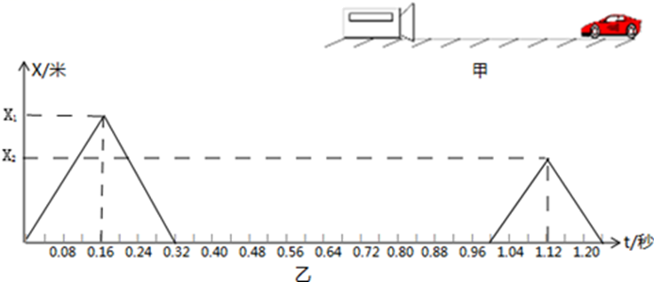

# Physics - 题目 2203

**ID**: 64e7c542822d476292220aa32f29a652
**年级**: Grade 8
**难度**: Hard
**题型**: Calculation

## 题目
交通部门常用测速仪来检测车速。​​​​​​​‌测速原理是测速仪前后两次发出并接收到被测车反射回的超声波信号，再根据两次信号的时间差，测出车速，如图甲。某次测速中，测速仪发出与接收超声波的情况如图乙所示，X表示超声波与测速仪之间的距离。（假设越声波的速度为340 m $/$ s，且保持不变）。求：(1)超声波第一次遇到被测汽车时被测汽车与测速仪之间的距离X_{1}为多少？(2)超声波第二次遇到被测汽车时被测汽车与测速仪之间的距离X_{2}为多少？(3)被测汽车在这段时间内的平均速度为多少？(4)若此路段限速为50km/h，该被测汽车是否超速？

## 解答

1. 解：(1)由图知，汽车第一次遇到测速仪发出的超声波时，经过的时间为
2. t_{1}=0.16s
3. 由 $v=\frac {s}{t}$ 可得汽车此时与测速仪之间的距离
4. $X{{}_{1}}=v{{}_{声}}t{{}_{1}}=340{\rm{m}}{\rm{/}}{\rm{s}}\times 0.16{\rm{s}}=54.4{\rm{m}}$
5. (2)由图知，汽车第二次接收到超声波时，经过的时间为为0.12s，由 $v=\frac {s}{t}$ 可得汽车此时与测速仪之间的距离
6. $X{{}_{2}}=v{{}_{声}}t{{}_{2}}=340{\rm{m}}{\rm{/}}{\rm{s}}\times 0.12{\rm{s}}=40.8{\rm{m}}$
7. (3)汽车遇到两次超声波信号距离测速仪的距离差
8. $ΔX=X{{}_{1}}-X{{}_{2}}=54.4{\rm{m}}-40.8{\rm{m}}=13.6{\rm{m}}$
9. 汽车遇到两次超声波信号经过的时间
10. $Δt=1.12{\rm{s}}-0.16{\rm{s}}=0.96{\rm{s}}$
11. 则被测汽车在这段时间内的平均速度
12. $v=\frac {ΔX}{Δt}=\frac {13.6{\rm{m}}}{0.96{\rm{s}}}\approx 14.17{\rm{m}}{\rm{/}}{\rm{s}}$
13. (4)若此路段限速为
14. $50{\rm{k}}{\rm{m}}{\rm{/}}{\rm{h}}\approx 13.89{\rm{m}}{\rm{/}}{\rm{s}}$
15. 小于车的速度，所以被测汽车超速。
16. 答：(1)超声波第一次遇到被测汽车时被测汽车与测速仪之间的距离X_{1}为54.4m；
17. (2)超声波第二次遇到被测汽车时被测汽车与测速仪之间的距离X_{2}为40.8m；
18. (3)被测汽车在这段时间内的平均速度为14.17m/s；
19. (4)若此路段限速为50km/h，该被测汽车超速。

## 知识点

**中文**:
  - 回声测距离的应用
  - 速度公式及其应用
  - 速度的综合计算

**English**:
  - Distance Measurement using Echo
  - Velocity Formula and Applications
  - Comprehensive Velocity Calculations

---
