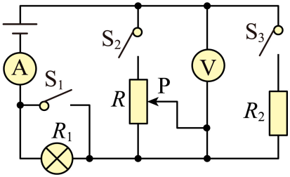

# Physics - 题目 1580

**ID**: 7c1ceaa0b4504c898c73062cd880017e
**年级**: Grade 8
**难度**: Hard
**题型**: Calculation

## 题目
如图所示的电路中，电源电压U恒定，R_{2}是定值电阻，电流表和电压表接入电路的量程分别是“0~0.6A”、“0~15V”，小灯泡R_{1}上标有“1.5V  0.6W”。​​​​​​​‌只闭合开关S_{2}时，滑片P位于滑动变阻器R上某一位置C时，电流表示数为I，R_{1}两端的电压为1.0V；再将滑片P向上移动，使R的阻值变化5Ω，电流表示数增大了0.1A，此时R_{1}刚好正常发光，R消耗的功率为P_{1}。求：（1）小灯泡R_{1}正常工作时的电流；（2）电源电压U；（3）当开关S_{1}、S_{2}、S_{3}都闭合时，在确保电路安全的情况下，移动滑动变阻器R的滑片P，当电路的电功率最大时，R消耗的功率是P_{2}，已知 $P{{}_{1}}∶P{{}_{2}}=8∶11$ ，求R₂的阻值。

## 解答

1. 解：（1）小灯泡R_{1}正常工作时的电流 $I{{}_{{\rm{L}}}}=\frac {P{{}_{{\rm{L}}}}}{U{{}_{{\rm{L}}}}}=\frac {0.6{\rm{W}}}{1.5{\rm{V}}}=0.4{\rm{A}}$ 。
2. （2）由电路图可知，只闭合开关S_{2}时，R与R1串联，电流表测电路中电流，滑片P位于滑动变阻器R上某一位置C时，电流表示数为I，R_{1}两端的电压为1.0V；再将滑片P向上移动，使R的阻值变化5Ω，电流表示数增大了0.1A，此时R_{1}刚好正常发光，则此时电路中电流为 $I^{′}=I{{}_{{\rm{L}}}}=0.4{\rm{A}}$ ，则未将滑片P向上移动时，电路中电流 $I=0.4{\rm{A}}-0.1{\rm{A}}=0.3{\rm{A}}$ ，由题意可得，未将滑片P向上移动时，电源电压 $U=U{{}_{1}}+U{{}_{{\rm{R}}}}=1.0{\rm{V}}+IR{{}_{C}}=1{\rm{V}}+0.3{\rm{A}}\times R{{}_{C}}$    ①，将滑片P向上移动，使R的阻值变化5Ω，电流表示数增大了0.1A，此时R_{1}刚好正常发光，则R_{1}刚好正常发光的电阻 $R{{}_{1}}=\frac {U{{}_{{\rm{L}}}}}{I{{}_{{\rm{L}}}}}=\frac {1.5{\rm{V}}}{0.4{\rm{A}}}=3.75Ω$ ，电源电压 $U=U{{}_{1}}{^{\prime }}+U{{}_{{\rm{R}}}}{^{\prime }}=0.4{\rm{A}}\times 3.75{\rm{Ω}}+0.4{\rm{A}}\times \left ({R{{}_{C}}-5{\rm{Ω}}}\right )$    ②，由①②可得 $R{{}_{C}}=15Ω$ ， $U=5.5{\rm{V}}$ ，此时R消耗的功率为 $P{{}_{1}}=I^{′}{{^{2}}}R{{}_{C}}{^{\prime }}={\left({0.4{\rm{A}}}\right)^{2}}\times \left ({15{\rm{Ω}}-5{\rm{Ω}}}\right )=1.6{\rm{W}}$ 。
3. （3）当开关S_{1}、S_{2}、S_{3}都闭合时，R与R_{2}并联，电流表测干路电流。因 $\frac {P{{}_{1}}}{P{{}_{2}}}=\frac {8}{11}$ ，则 $P{{}_{2}}=\frac {11P{{}_{1}}}{8}=\frac {11}{8}\times 1.6{\rm{W}}=2.2{\rm{W}}$ ，则通过R的电流 $I{{}_{{\rm{R}}}}=\frac {P{{}_{2}}}{U}=\frac {2.2{\rm{W}}}{5.5{\rm{V}}}=0.4{\rm{A}}$ ，因电流表量程为0~0.6A，则电路中最大电流为 $I{{}_{大}}=\frac {P{{}_{2}}}{U}=\frac {2.2{\rm{W}}}{5.5{\rm{V}}}=0.4{\rm{A}}$ ，由P=UI可知，当电路中电流最大时，电路中电功率最大，则此时通过R_{2}的电流为 $I{{}_{2}}=I{{}_{大}}-I{{}_{{\rm{R}}}}=0.6{\rm{A}}-0.4{\rm{A}}{\rm{=}}{{0}}{{.}}{{2}}{\rm{A}}$ ，则 $R{{}_{2}}=\frac {U}{I{{}_{2}}}=\frac {5.5{\rm{V}}}{0.2{\rm{A}}}=27.5Ω$ 。
4. 答：（1）小灯泡R_{1}正常工作时的电流为0.4A；
5. （2）电源电压为5.5V；
6. （3）R₂的阻值为27.5Ω。

## 知识点

**中文**:
  - 欧姆定律的应用
  - 电路的动态分析
  - 电功率的计算及应用

**English**:
  - Applications of Ohm's Law
  - Dynamic Circuit Analysis
  - Calculation and Application of Electric Power

---
