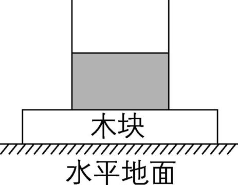

# Physics - 题目 2535

**ID**: 8431266035304fcbaeb7bd9827d556aa
**年级**: Grade 8
**难度**: Hard
**题型**: Calculation

## 题目
如图所示，质量为 $4\mathrm{ }\mathrm{k}\mathrm{g}$ 、底面积为 $4×{10}^{-2}\mathrm{ }{\mathrm{m}}^{2}$ 的长方体木块放置在水平地面上，现将盛有 $6×{10}^{-3}\mathrm{ }{\mathrm{m}}^{3}$ 水的轻质薄壁圆柱形容器放在木块的中央，已知圆柱形容器的底面积为 $2×{10}^{-2}\mathrm{ }{\mathrm{m}}^{2}$ 。​​​​​​​‌ $(g$ 取 $10\mathrm{ }\mathrm{N}/\mathrm{k}\mathrm{g})$（1） 求容器内水对容器底的压强。（2） 求木块对地面的压强。（3） 现将一均匀实心小球放在该圆柱形容器内的水中（容器足够高，小球浸没），此时水对容器底部压强的增加量为 $\mathrm{\Delta }{p}_{水}$ ，木块对地面压强的增加量为 $\mathrm{\Delta }{p}_{木}$ ，若 $\mathrm{\Delta }{p}_{水}:\mathrm{\Delta }{p}_{木}=10:7$ ，求实心小球的密度。

## 解答

1. （1） 容器内水的深度 ${h}_{水}=\frac{{V}_{水}}{{S}_{容}}=\frac{6×{10}^{-3}\mathrm{ }{\mathrm{m}}^{3}}{2×{10}^{-2}\mathrm{ }{\mathrm{m}}^{2}}=0.3\mathrm{ }\mathrm{m}$ ，容器内水对容器底的压强 ${p}_{水}={\rho }_{水}g{h}_{水}=1×{10}^{3}\mathrm{ }\mathrm{k}\mathrm{g}/{\mathrm{m}}^{3}×10\mathrm{ }\mathrm{N}/\mathrm{k}\mathrm{g}×0.3\mathrm{ }\mathrm{m}=3×{10}^{3}\mathrm{ }\mathrm{P}\mathrm{a}$ 。
2. （2） 容器中水的质量 ${m}_{水}={\rho }_{水}{V}_{水}=1×{10}^{3}\mathrm{ }\mathrm{k}\mathrm{g}/{\mathrm{m}}^{3}×6×{10}^{-3}\mathrm{ }{\mathrm{m}}^{3}=6\mathrm{ }\mathrm{k}\mathrm{g}$ ，因为圆柱形容器的质量不计，故木块对地面的压力 $F={G}_{总}=({m}_{水}+{m}_{木})g=(6\mathrm{ }\mathrm{k}\mathrm{g}+4\mathrm{ }\mathrm{k}\mathrm{g})×10\mathrm{ }\mathrm{N}/\mathrm{k}\mathrm{g}=100\mathrm{ }\mathrm{N}$ ，木块对地面的压强 ${p}_{木}=\frac{F}{{S}_{木}}=\frac{100\mathrm{ }\mathrm{N}}{4×{10}^{-2}\mathrm{ }{\mathrm{m}}^{2}}=2.5×{10}^{3}\mathrm{ }\mathrm{P}\mathrm{a}$ 。
3. （3） 设实心小球的体积为 $V$ ，实心小球浸没在水中，排开水的体积 ${V}_{排}=V$ ，水面升高的高度 $\mathrm{\Delta }h=\frac{{V}_{排}}{{S}_{容}}=\frac{V}{{S}_{容}}$ ，水对容器底部压强的增加量 $\mathrm{\Delta }{p}_{水}={\rho }_{水}g\mathrm{\Delta }h={\rho }_{水}g\frac{V}{{S}_{容}}\mathrm{①}$ ；木块对地面压力的增加量 $\mathrm{\Delta }F={G}_{球}={m}_{球}g$ ，木块对地面压强的增加量 $\mathrm{\Delta }{p}_{木}=\frac{\mathrm{\Delta }F}{{S}_{木}}=\frac{{m}_{球}g}{{S}_{木}}\mathrm{②}$ ；由题知 $\mathrm{\Delta }{p}_{水}:\mathrm{\Delta }{p}_{木}=10:7\mathrm{③}$ ，将①②代入③式，即 ${\rho }_{水}g\frac{V}{{S}_{容}}:\frac{{m}_{球}g}{{S}_{木}}=10:7$ ，可得 $\frac{{\rho }_{水}V{S}_{木}}{{S}_{容}{m}_{球}}=\frac{10}{7}$ ，整理可得小球的密度 ${\rho }_{球}=\frac{{m}_{球}}{V}=\frac{7{\rho }_{水}{S}_{木}}{10{S}_{容}}=\frac{7×1×{10}^{3}\mathrm{ }\mathrm{k}\mathrm{g}/{\mathrm{m}}^{3}×4×{10}^{-2}\mathrm{ }{\mathrm{m}}^{2}}{10×2×{10}^{-2}\mathrm{ }{\mathrm{m}}^{2}}=1.4×{10}^{3}\mathrm{ }\mathrm{k}\mathrm{g}/{\mathrm{m}}^{3}$ 。

## 知识点

**中文**:
  - 压强的计算
  - 液体压强计算公式的应用

**English**:
  - Calculation of Pressure
  - Application of Liquid Pressure Formula

---
