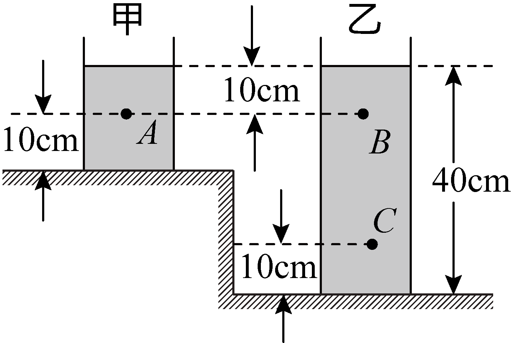

# Physics - 题目 772

**ID**: bf0f82fc2acc4189bcc9973be4ed0aa0
**年级**: Grade 8
**难度**: Hard
**题型**: Calculation

## 题目
如图所示，在高低不同的两个水平面上，放着甲、乙两只高度不同、底面积相同的圆柱形薄壁玻璃杯，两只杯里装着适量的水，静止时两液面相平。​​​​​​​‌已知乙杯中液面到杯底的距离为40cm，甲杯中A点到液面的距离及到杯底的距离均为10cm，乙杯中B点到液面的距离及C点到底部的距离也为10cm。（ρ_{水}=1×10^{3}kg/m^{3}，g=10N/kg）（1）A、B、C三点位置受到水的压强分别是p_{A}、p_{B}、p_{C}，则它们之间的大小关系为：；（2）请求出C点所受到水的压强的大小；（）（3）现把甲杯中的水换成另一种液体，当液面与乙杯中的水相平时，两杯中的液体质量恰好相等。甲杯中的液体对杯底的压强（选填“大于”、“等于”或“小于”）乙杯中的水对杯底的压强；如果A、B、C三点的位置不变，它们受到液体的压强分别是p_{A}'、p_{B}'、p_{C}'，则它们之间的大小关系为。

## 解答

1. 解：（1）从图中可知A、B、C三点的深度
2. $h{{}_{A}}=h{{}_{B}}<h{{}_{C}}$
3. 根据p=ρ_{水}gh可知它们之间的大小关系是
4. $p{{}_{A}}=p{{}_{B}}<p{{}_{C}}$
5. （2）从图中可以看到，乙杯中液面的高度是40cm，C点到底部的距离是10cm，那么C点的深度是
6. $h{{}_{C}}={\rm{4}}{\rm{0}}{\rm{c}}{\rm{m}}-{\rm{1}}{\rm{0}}{\rm{c}}{\rm{m}}={\rm{3}}{\rm{0}}{\rm{c}}{\rm{m}}={\rm{0}}{\rm{.}}{\rm{3}}{\rm{m}}$
7. 根据液体的压强公式可知，C点所受到水的压强是
8. $p{{}_{C}}=ρ{{}_{水}}gh{{}_{C}}=1.0\times 1{\rm{0}}{^{{\rm{3}}}}{\rm{k}}{\rm{g}}{\rm{/}}{\rm{m}}{^{{\rm{3}}}}\times 1{\rm{0}}{\rm{N}}{\rm{/}}{\rm{k}}{\rm{g}}\times {\rm{0}}{\rm{.}}{\rm{3}}{\rm{m}}=3000{\rm{P}}{\rm{a}}$
9. C点所受到水的压强是3000Pa。
10. （3）甲、乙两圆柱形薄壁玻璃杯，且两杯中的液体质量恰好相等，那么两杯中的液体重力相等，根据F=G可知两杯中的液体对容器底部的压力相等，两容器的底面积相同，根据 $p=\frac {F}{S}$ 可知甲杯中的液体对杯底的压强等于乙杯中的水对杯底的压强。
11. 由乙图可知，B点的深度小于C点的深度，根据p=ρ_{液}gh可知，B点所受液体的压强比C点小，故p_{B}'<p_{C}'；
12. 两只杯里装有相同质量的不同液体，甲杯液体的体积小于乙杯液体的体积，根据 $ρ=\frac {m}{V}$ 可知甲杯液体的密度大于乙杯液体的密度，A、B两点的液体深度相同，根据p=ρgh可知p_{A}'>p_{B}'；
13. 已知甲杯中的液体对杯底的压强等于乙杯中的水对杯底的压强，A、C两点距两杯底的深度相同，根据p=ρ_{液}gh可知A点所处水平面以下的液体对甲杯底部的压强大于C点所处水平面以下的液体对乙杯底部的压强。甲杯中的液体对杯底的压强大小等于A点所处水平面以上的液体对A点的压强加上A点所处水平面以下的液体对甲杯底部的压强之和，乙杯中的水对杯底的压强大小等于C点所处水平面以上的水对C点的压强加上C点所处水平面以下的水对乙杯底部的压强之和，即
14. $p{{}_{甲}}=p{{}_{乙}}$
15. $p{{}_{甲}}=p{{}_{A}^{^{′}}}+p{{}_{A}^{^{′′}}}$
16. $p{{}_{乙}}=p{{}_{C}^{^{′}}}+p{{}_{C}^{^{′′}}}$
17. 那么
18. $p{{}_{A}^{^{′}}}+p{{}_{A}^{^{′′}}}=p{{}_{C}^{^{′}}}+p{{}_{C}^{^{′′}}}$
19. 其中p_{甲}是甲杯中的液体对杯底的压强，p_{乙}是乙杯中的水对杯底的压强， $p{{}_{A}^{^{′}}}$ 是A点所处水平面以上的液体对A点的压强， $p{{}_{A}^{^{′′}}}$ 是A点所处水平面以下的液体对甲杯底部的压强， $p{{}_{C}^{^{′}}}$ 是C点所处水平面以上的水对C点的压强， $p{{}_{C}^{^{′′}}}$ 是C点所处水平面以下的水对乙杯底部的压强，因为 $p{{}_{A}^{^{′′}}}>p{{}_{C}^{^{′′}}}$ ，那么 $p{{}_{A}^{^{′}}}<p{{}_{C}^{^{′}}}$ ，由上述可知， $p{{}_{A}^{^{′}}}>p{{}_{B}^{^{′}}}$ ，那么可得到三点压强大小关系为
20. $p{{}_{C}^{^{′}}}>p{{}_{A}^{^{′}}}>p{{}_{B}^{^{′}}}$

## 知识点

**中文**:
  - 压强大小的比较
  - 液体压强计算公式的应用
  - 液体压强的判断与计算

**English**:
  - Comparing Pressure
  - Application of Liquid Pressure Formula
  - Determination and Calculation of Liquid Pressure

---
