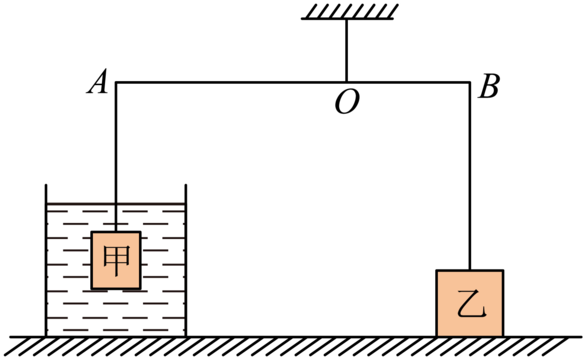

# Physics - 题目 99

**ID**: cdc946b8831d451fbcf0a3b43850c75a
**年级**: Grade 8
**难度**: Hard
**题型**: Calculation

## 题目
如图所示，轻质杠杆AB可绕O点转动，当物体甲浸没在水中时杠杆恰好水平静止（水不溢出），A、B两端的绳子均不可伸长且处于张紧状态。​​​​​​​‌已知甲是体积为10^{-3}m^{3}、重为60N的实心物体，乙是边长为20cm、质量为30kg的正方体，OA∶OB=2∶1，圆柱形容器的底面积为500cm^{2}，g=10N/kg。求：（1）物体甲浸没在水中的浮力F_{浮}；（2）杠杆A端受到细线的拉力F_{A}；（3）物体乙对地面的压强p_{乙}；（4）请选择合适的研究对象，画出受力分析图，分析并计算物体甲浸没在水中之后与物体甲放入水中之前相比，容器对桌面的压强变化Δp。

## 解答

1. 解：（1）因为物体甲浸没在水中，所以
2. $V{{}_{排}}=V{{}_{甲}}=10{^{-3}}{\rm{m}}{^{{{3}}}}$
3. 物体甲浸没在水中的浮力
4. $F{{}_{浮}}=ρ{{}_{水}}gV{{}_{排}}=1.0\times 10{^{3}}{{\rm{k}}{\rm{g}}}/{{\rm{m}}{^{{{3}}}}}\times 10{{\rm{N}}}/{{\rm{k}}{\rm{g}}}\times 10{^{-3}}{\rm{m}}{^{{{3}}}}=10{\rm{N}}$
5. （2）杠杆A端受到细线的拉力与细线对甲的拉力大小相等，即
6. $F{{}_{A}}=F{{}_{拉}}=G-F{{}_{浮}}=60{\rm{N}}-10{\rm{N}}=50{\rm{N}}$
7. （3）根据杠杆平衡条件可知，B端细线拉力为
8. $F{{}_{A}}l{{}_{{\rm{O}}{\rm{A}}}}=F{{}_{B}}l{{}_{{\rm{O}}{\rm{B}}}}$
9. $F{{}_{B}}=\frac {F{{}_{A}}OA}{OB}=50{\rm{N}}\times \frac {2}{1}=100{\rm{N}}$
10. 乙的重力为
11. $G{{}_{乙}}=m{{}_{乙}}g=30{\rm{k}}{\rm{g}}\times 10{{\rm{N}}}/{{\rm{k}}{\rm{g}}}=300{\rm{N}}$
12. 乙对地面的压力为
13. $F{{}_{乙}}=G{{}_{乙}}-F{{}_{B}}=300{\rm{N}}-100{\rm{N}}=200{\rm{N}}$
14. 乙的底面积为
15. $S{{}_{乙}}=l{^{2}}=(0.2{\rm{m}}){^{2}}=0.04{\rm{m}}{^{{{2}}}}$
16. 物体乙对地面的压强
17. $p{{}_{乙}}=\frac {F{{}_{乙}}}{S{{}_{乙}}}=\frac {200{\rm{N}}}{0.04{\rm{m}}{^{{{2}}}}}=5\times 10{^{3}}{\rm{P}}{\rm{a}}$
18. （4）对圆柱形容器和水进行受力分析，物体甲放入前，圆柱形容器和水受到向下的重力，地面对其向上的支持力，物体甲放入后，圆柱形容器和水受到向下的重力，地面对其向上的支持力，物体甲对其向下的压力，如图所示：
19. 
20. 通过受力分析可知，物体甲浸没在水中之后与物体甲放入水中之前相比，增加了一个压力，此压力与物体甲受到的浮力是相互作用力，大小相等，即容器对桌面的压力变化
21. $\Delta F=F{{}_{浮}}=10{\rm{N}}$
22. 容器的底面积
23. $S=500{\rm{c}}{\rm{m}}{^{{{2}}}}=0.05{\rm{m}}{^{{{2}}}}$
24. 容器对桌面的压强变化
25. $\Delta p=\frac {\Delta F}{S}=\frac {10{\rm{N}}}{0.05{\rm{m}}{^{{{2}}}}}=200{\rm{P}}{\rm{a}}$
26. 答：（1）物体甲浸没在水中的浮力F_{浮}为10N；
27. （2）杠杆A端受到细线的拉力F_{A}为50N；
28. （3）物体乙对地面的压强p_{乙}为5×10^{3}Pa；
29. （4）容器对桌面的压强变化Δp为200Pa。

## 知识点

**中文**:
  - 压强的计算
  - 阿基米德原理
  - 杠杆平衡条件的应用

**English**:
  - Calculation of Pressure
  - Archimedes' Principle
  - Application of Lever Equilibrium Conditions

---
