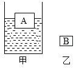

# Physics - 题目 1753

**ID**: cff5d6bd90a2461d98256ee9bb3dcb5a
**年级**: Grade 8
**难度**: Hard
**题型**: Calculation

## 题目
一底面积为300cm^{2}的柱形薄壁容器内装有足够深的水，一个边长为10cm的正方体物块A漂浮在水面上，有 $\frac {2}{5}$ 体积露出水面，如图甲所示。​​​​​​​‌已知ρ_{水}=1.0×10^{3}kg/m^{3}，g=10N/kg。（1）物块A的重力是多少？（2）另有一长方体物块B，如图乙所示。把B单独放在物块A上表面中心位置，A和B一起漂浮在水面上，此时水面相对容器上升了1cm（图未画出），请通过计算说明物块B有没有部分体积浸入水中？物块B的重力又是多少？

## 解答

1. 解：（1）由题意可知，物块A是一个边长为10cm的正方体，则物块A的体积是
2. $V{{}_{{\rm{A}}}}={\rm{0}}{\rm{.}}{\rm{1}}{\rm{m}}\times {\rm{0}}{\rm{.}}{\rm{1}}{\rm{m}}\times {\rm{0}}{\rm{.}}{\rm{1}}{\rm{m}}=1.0\times 1{\rm{0}}{^{{\rm{-}}{\rm{3}}}}{\rm{m}}{^{{\rm{3}}}}$
3. 物块A的体积是 $1.0\times 1{\rm{0}}{^{{\rm{-}}{\rm{3}}}}{\rm{m}}{^{{\rm{3}}}}$ ，有 $\frac {2}{5}$ 体积露出水面，那么有 $\frac {3}{5}$ 体积浸没在水中，物块A排开水的体积是
4. $V{{}_{排{\rm{A}}}}=\frac {3}{5}V{{}_{{\rm{A}}}}=\frac {3}{5}\times 1.0\times 1{\rm{0}}{^{{\rm{-}}{\rm{3}}}}{\rm{m}}{^{{\rm{3}}}}=6.0\times {\rm{1}}{\rm{0}}{^{{\rm{-}}{\rm{4}}}}{\rm{m}}{^{{\rm{3}}}}$
5. 物块A排开水的体积是 $6.0\times {\rm{1}}{\rm{0}}{^{{\rm{-}}{\rm{4}}}}{\rm{m}}{^{{\rm{3}}}}$ 。
6. 从甲图可以看到，物块A漂浮在水中，根据阿基米德原理可知，物块A受到的浮力大小是
7. $F{{}_{浮{\rm{A}}}}=ρ{{}_{水}}gV{{}_{排{\rm{A}}}}=1.0\times {\rm{1}}{\rm{0}}{^{{\rm{3}}}}{\rm{k}}{\rm{g}}{\rm{/}}{\rm{m}}{^{{\rm{3}}}}\times 1{\rm{0}}{\rm{N}}{\rm{/}}{\rm{k}}{\rm{g}}\times {\rm{6}}{\rm{.}}{\rm{0}}\times {\rm{1}}{\rm{0}}{^{{\rm{-}}{\rm{4}}}}{\rm{m}}{^{{\rm{3}}}}={\rm{6}}{\rm{N}}$
8. 物块A受到的浮力大小是6N，根据物体的浮沉条件可知，物块A漂浮在水中，物块A受到的重力大小等于其浮力大小，那么
9. $G{{}_{{\rm{A}}}}=F{{}_{浮{\rm{A}}}}={\rm{6}}{\rm{N}}$
10. 物块A受到的重力大小是6N。
11. （2）由题意可知，此时水面相对容器上升了1cm，柱形薄壁容器底面积为300cm^{2}，则物块A排开水的体积增加量是
12. $\Delta V{{}_{排{\rm{A}}}}=S\cdot \Delta h=300\times {\rm{1}}{\rm{0}}{^{{\rm{-}}{\rm{4}}}}{\rm{m}}{^{{\rm{2}}}}\times {\rm{0}}{\rm{.}}{\rm{0}}{\rm{1}}{\rm{m}}=3\times 1{\rm{0}}{^{{\rm{-}}{\rm{4}}}}{\rm{m}}{^{{\rm{3}}}}$
13. 物块A排开水的体积增加量是 $3\times 1{\rm{0}}{^{{\rm{-}}{\rm{4}}}}{\rm{m}}{^{{\rm{3}}}}$ ；由（1）解析可知，物块A的体积是 $1\times 1{\rm{0}}{^{{\rm{-}}{\rm{3}}}}{\rm{m}}{^{{\rm{3}}}}$ ，物块A排开水的体积是 $6\times {\rm{1}}{\rm{0}}{^{{\rm{-}}{\rm{4}}}}{\rm{m}}{^{{\rm{3}}}}$ ，则物块A在水外的体积是
14. $V{{}_{{\rm{A}}}^{^{′}}}=V{{}_{{\rm{A}}}}-V{{}_{排{\rm{A}}}}=10\times 1{\rm{0}}{^{{\rm{-}}{\rm{4}}}}{\rm{m}}{^{{\rm{3}}}}-6\times 1{\rm{0}}{^{{\rm{-}}{\rm{4}}}}{\rm{m}}{^{3}}=4\times 1{\rm{0}}{^{{\rm{-}}{\rm{4}}}}{\rm{m}}{^{{\rm{3}}}}$
15. 由于物块A排开水的体积增加量是 $3\times 1{\rm{0}}{^{{\rm{-}}{\rm{4}}}}{\rm{m}}{^{{\rm{3}}}}$ ，那么物块A在水外还剩的体积是
16. $V{{}_{{\rm{A}}}^{^{′′}}}=V{{}_{{\rm{A}}}^{^{′}}}-\Delta V{{}_{排{\rm{A}}}}=4\times 1{\rm{0}}{^{{\rm{-}}{\rm{4}}}}{\rm{m}}{^{{\rm{3}}}}-3\times {\rm{1}}{\rm{0}}{^{{\rm{-}}{\rm{4}}}}{\rm{m}}{^{{\rm{3}}}}=1\times 1{\rm{0}}{^{{\rm{-}}{\rm{4}}}}{\rm{m}}{^{{\rm{3}}}}$
17. 物块A在水外还剩的体积是 $1\times 1{\rm{0}}{^{{\rm{-}}{\rm{4}}}}{\rm{m}}{^{{\rm{3}}}}$ ，那么物块A没有完全浸没在水中，B单独放在物块A上表面中心位置，物块B没有部分体积浸入水中。
18. 由以上计算可知，物块B没有部分浸入水中，则物块B自身的重力大小加上物块A的重力大小之和，等于这情况下物块A受到的浮力大小，由（1）解析可知，物块A受到的重力大小等于没有放物块B时的浮力大小，那么增加的浮力大小等于物块B的重力大小，即
19. $G{{}_{{\rm{B}}}}=\Delta F{{}_{浮{\rm{A}}}}=ρ{{}_{水}}g\Delta V{{}_{排{\rm{A}}}}=1.0\times {\rm{1}}{\rm{0}}{^{{\rm{3}}}}{\rm{k}}{\rm{g}}{\rm{/}}{\rm{m}}{^{3}}\times 1{\rm{0}}{\rm{N}}{\rm{/}}{\rm{k}}{\rm{g}}\times 3\times {\rm{1}}{\rm{0}}{^{{\rm{-}}{\rm{4}}}}{\rm{m}}{^{{\rm{3}}}}={\rm{3}}{\rm{N}}$
20. 物块B的重力大小是3N。
21. 答：（1）物块A的重力是6N；
22. （2）物块B没有部分体积浸入水中，物块B的重力是3N。

## 知识点

**中文**:
  - 物体的浮沉条件及其应用
  - 阿基米德原理的应用

**English**:
  - Floating/Sinking Conditions and Applications
  - Applications of Archimedes' Principle

---
