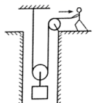

# Physics - 题目 1520

**ID**: fde9b7e9208446aea34c047ca64e4fd8
**年级**: Grade 8
**难度**: Hard
**题型**: Calculation

## 题目
使用如图所示的机械装置，某人从井里提升78kg的重物，在10s内沿水平地面向右匀速行走了8m，该人拉绳子的力是400N（绳重与摩擦忽略不计）。​​​​​​​‌求：(1)物体上升的速度是多少？(2)拉力的功率是多少？(3)该装置的机械效率是多少？(4)动滑轮的重力是多少？

## 解答

1. (1)人移动的距离 $s{{}_{人}}{\rm{=}}{\rm{8}}{\rm{m}}$ ，所用的时间 $t{\rm{=}}10{\rm{s}}$ ，人移动的速度
2. $v{{}_{人}}=\frac {s{{}_{人}}}{t}{\rm{=}}\frac {8{\rm{m}}}{10{\rm{s}}}{\rm{=}}0.8{\rm{m}}/{\rm{s}}$
3. 物体移动的速度
4. $    $     $v{{}_{物}}{\rm{=}}\frac {1}{2}v{{}_{人}}{\rm{=}}\frac {1}{2}\times 0.8{\rm{m}}/{\rm{s}}{\rm{=}}0.4{\rm{m}}/{\rm{s}}$
5. (2)拉力做的功
6. $W{{}_{总}}=Fs{\rm{=}}400{\rm{N}}\times 8{\rm{m}}{\rm{=}}{\rm{3}}{\rm{2}}{\rm{0}}{\rm{0}}{\rm{J}}$
7. 拉力的功率
8. $P=\frac {W{{}_{总}}}{t}{\rm{=}}\frac {{\rm{3}}{\rm{2}}{\rm{0}}{\rm{0}}{\rm{J}}}{{\rm{1}}{\rm{0}}{\rm{s}}}{\rm{=}}320{\rm{W}}$
9. (3)物体上升的高度
10. $h=\frac {1}{2}s{{}_{人}}{\rm{=}}\frac {{\rm{1}}}{{\rm{2}}}\times {\rm{8}}{\rm{m}}{\rm{=}}{\rm{4}}{\rm{m}}$
11. 该装置的机械效率
12. $η=\frac {W{{}_{有}}}{W{{}_{总}}}=\frac {G{{}_{物}}h}{W{{}_{总}}}=\frac {m{{}_{物}}gh}{W{{}_{总}}}{\rm{=}}\frac {{\rm{7}}{\rm{8}}{\rm{k}}{\rm{g}}\times {\rm{1}}{\rm{0}}{\rm{N}}{\rm{/}}{\rm{k}}{\rm{g}}\times {\rm{4}}{\rm{m}}}{{\rm{3}}{\rm{2}}{\rm{0}}{\rm{0}}{\rm{J}}}{\rm{=}}{\rm{9}}{\rm{7}}{\rm{.}}{\rm{5}}{\rm{\%}}$
13. (4)动滑轮的重力
14. $G{{}_{动}}=2F-G{{}_{物}}{\rm{=}}{\rm{2}}\times {\rm{4}}{\rm{0}}{\rm{0}}{\rm{N}}{\rm{-}}{\rm{7}}{\rm{8}}{\rm{0}}{\rm{N}}{\rm{=}}{\rm{2}}{\rm{0}}{\rm{N}}$
15. 答：(1)物体移动的速度是0.4m/s；
16. (2)拉力的功率是320W；
17. (3)该装置的机械效率是97.5%；
18. (4)动滑轮的重力是20N。

## 知识点

**中文**:
  - 功率的计算和估算
  - 功的计算和估算
  - 滑轮组及其工作特点
  - 滑轮（组）的机械效率及其计算

**English**:
  - Calculation and Estimation of Power
  - Calculation and Estimation of Work
  - Pulley Systems and Operating Characteristics
  - Mechanical Efficiency of Pulleys and Calculations

---
