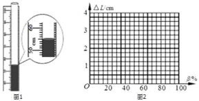

# Physics - 题目 317

**ID**: 168280e1871e467795f961d980133ced
**年级**: Grade 8
**难度**: Hard
**题型**: Experiment

## 题目
在研究分子模型时，把相同体积的水和酒精充分混合，发现混合后的总体积小于混合前两液体的体积之和．为了确定减小的体积和酒精含量的关系，学习小组进行了如下探究：​​​​​​​‌

## 解答

1. （1）物质是由大量分子组成的，分子体积小，组成物体的分子间存在间隙，所以，当把酒精和水混合以后，两种分子不发生化学反应，两种物质的分子相互穿插渗透，进入彼此的分子间隙里，所以总体积会小于二者的体积之和，故选C；
2. （2）①由图1知道，刻度尺的分度值为1cm，所以，第2次实验水面水面的刻度是55.0cm．设细玻璃管的横截面积为S，水柱的质量是：m_{水}=ρ_{水}V_{水}=ρ_{水}SL_{1}，酒精柱的质量是：m_{酒精}=ρ_{酒精}V_{酒精}=ρ_{酒精}SL_{2}，则酒精质量的含量是：β=m_{酒精}/（m_{水}+m_{酒精}）×100%=ρ_{酒精}SL_{2}/ρ_{水}SL_{1}+ρ_{酒精}SL_{2}×100%=ρ_{酒精}L_{2}/ρ_{水}L_{1}+ρ_{酒精}L_{2}×100%，由表格数据知道，第3次实验水柱长度是：L_{1}=44.0cm，酒精柱的长度是：L_{2}=100cm-44.0cm=56.0cm，故解得：β≈50%；第4次实验液柱减小的长度是：△L=100cm-97.4cm=2.6cm．
3. ②将表中的数据（1.9，20）、（3.2，40）、（3.6，50）、（2.6，60）、（1.6，80）在图2坐标系中描点连线如图所示：
4. 
5. 由图像知道，在水和酒精混合前的总体积相同的前提下，混合后的体积减小量（△L）随着酒精质量含量（β）的增大而先增大后减小．

## 知识点

**中文**:
  - 分子动理论

**English**:
  - Kinetic Theory

---
