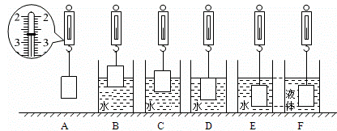
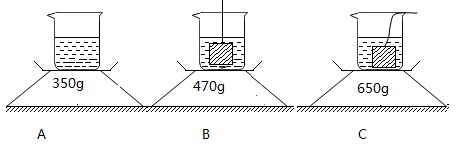
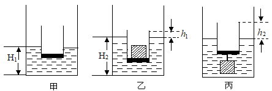

# Physics - 题目 2146

**ID**: 2c381f23445146a4a52aad120192d37f
**年级**: Grade 8
**难度**: Hard
**题型**: Experiment

## 题目
在学习浮力部分知识时聋萱想要探究“浮力的大小和哪些因素有关”，操作步骤如图 a、b、c、d、e、f所示∶实验步骤bcdef测力计示数/N2.42.32.22.22.0（1）在实验步骤b中物体所受的浮力为N.（2）分析实验步骤a、b、c、d，浸在水中的物体所受的浮力与有关；分析三个实验步骤，浸没在水中的物体所受的浮力与深度（选填 “有关”或“无关”）。​​​​​​​‌（3）萱萱用表格中的数据算出了步骤f中液体的密度是kg/m^{3}。（4）同组的小鲁同学想用电子秤来测量矿石的密度，实验步骤如下：①电子秤放在水平桌面上，装有适量水的烧杯放在电子秤上，电子秤示数如图A所示；②把被测矿石用细线拴好，缓慢放入装有水的烧杯中，矿石未触碰到烧杯底部，电子秤的示数如图B所示，③然后缓慢放下矿石，让被测矿石沉入烧杯底部，如图C所示。根据实验步骤中的数据，可测出被测矿石的质量是g，被测到矿石的密度是kg/m^{3}（5）小鲁同学想到还可以利用这一矿石测量未知液体的密度，她进行了如下操作∶①在圆柱形容器中装适量的这一液体， 将另一平底烧杯放入圆柱形容器的液体中，烧杯静止时容器中液体的深度H_{1}=0.13m，如图甲所示；②将刚才实验中的矿石擦干水放入烧杯中，此时烧杯静止时露出液面的高度h_{1}=0. 04m，容器中液体的深度H_{2}=0.18m，如图乙所示；③将矿石拴在烧杯底部，烧杯静止时露出液面的高度为h_{2}=0. 07m，如图丙所示，已知圆柱形容器底部面积为烧杯底面积的2倍。则这一液体的密度为kg/m^{3}。

## 解答

1. 弹簧测力计的分度值为0.1N，由指针位置可知，A步骤所示弹簧测力计的示数为2.7N，由表格数据可知，在实验步骤b中拉力为2.4N，则步骤b中物体所受浮力
2. F_{浮}=G-F_{拉}=2.7N-2.4N=0.3N
3. 由a、b、c、d所示实验可知物体排开水的体积越大，物体受到的浮力越大，由此可知：浸在水中的物体所受浮力大小跟物体排开液体的体积有关。由a、d、e实验可知，物体排开液体体积相同液体密度相同，物体所处的深度不同，物体受到的浮力相同，说明物体在同种液体、排开相同体积时，所受浮力大小跟浸没在液体的深度无关。
4. 在f图中，V_{排}_{1}=V_{物}，由实验步骤a、d可知，物体在水中受到的浮力
5. F_{浮}_{1}=G-F_{拉}_{1}=2.7N-2.2N=0.5N
6. 由F_{浮}= $ρ$_{水}gV_{排}_{1}可得
7. V_{排}_{1}$=\frac {F{{}_{浮}}}{ρ{{}_{水}}g}=\frac {0.5{\rm{N}}}{1.0\times 10{^{3}}{\rm{k}}{\rm{g}}/{\rm{m}}{^{3}}\times 10{\rm{N}}/{\rm{k}}{\rm{g}}}=$ 5 $\times $ 10^{-3}m^{3}
8. 在f图中，物体受到的浮力
9. F_{浮}＇ $=$G-F_{拉}＇=2.7N-2.0N=0.7N= $ρ$_{液}gV_{排}_{2}
10. V_{排}_{1}=V_{物}$=$V_{排}_{2}
11. 即
12. 0.7N= $ρ$_{液}gV_{排}_{2}$=$  $ρ$_{液}$\times 1$ 0N/kg $\times $ 5 $\times $ 10^{-3}m^{3}
13. 所以
14. $ρ$_{液}=1.4 $\times $ 10^{3}kg/m^{3}
15. 电子秤放在水平桌面上装有适量水的烧杯放在电子秤上，电子秤示数如图A所示，把被测矿石用细线栓好、缓慢放入装水水的烧杯中，示数如图C所示，则被测矿石的的质量为
16. m_{石}=650g-350g=300g
17. 把被测矿石用细线拴好，缓慢放入装有水的烧杯中，矿石未触碰到烧杯底部，电子秤的示数如图B所示，则矿石浸没在水中所受到的浮力为
18. F_{浮}=Δmg=(470-350) $\times 10{^{-3}}$ kg $\times $ 10N/kg=1.2N
19. 根据阿基米德定律可知：F_{浮}= $ρ$_{水}gV_{排}_{3}，又有G=mg=$ρ$_{石}gV_{石}，且石块排开水的体积等于石块体积，两式联立可得
20. $ρ$_{石}$=\frac {Gρ{{}_{水}}}{F{{}_{浮}}}=\frac {mgρ{{}_{水}}}{F{{}_{浮}}}=\frac {300\times 10{^{-3}}{\rm{k}}{\rm{g}}\times 10{\rm{N}}/{\rm{k}}{\rm{g}}\times 1.0\times 10{^{3}}{\rm{k}}{\rm{g}}/{\rm{m}}{^{3}}}{1.2{\rm{N}}}=$ 2.5 $\times $ 10^{3}kg/m^{3}
21. 由题可得
22. F_{浮石}= $ρ$_{液}gV_{排}_{4}= $ρ$_{液}(H_{2}-H_{1})Sg=m_{石}g
23. 因为F_{浮乙}=F_{浮丙}，所以假设烧杯高为h，则
24. F_{浮乙}= $ρ$_{液}gV_{排乙}$=ρ$_{液}g(h-h_{1})S；---------①
25. F_{浮丙}= $ρ$_{液}gV_{排丙}$=ρ$_{液}g[V_{石}+(h-h_{2})S]； --------②
26. 整理①②得
27. V_{石}=(h_{2}-h_{1})S
28. 因为
29. $ρ$_{石}$=\frac {m{{}_{石}}}{V{{}_{石}}}=\frac {ρ{{}_{液}}\left ({H{{}_{2}}-H{{}_{1}}}\right )S}{\left ({h{{}_{2}}-h{{}_{1}}}\right )S}=ρ{{}_{液}}$  $\times \frac {0.18{\rm{m}}-0.13{\rm{m}}}{0.07{\rm{m}}-0.04{\rm{m}}}=\frac {5}{3}ρ$_{液}
30. 所以
31. $ρ$_{液}$=\frac {3}{5}ρ$_{石}$=\frac {3}{5}\times $ 2.5 $\times $ 10^{3}kg/m^{3}$=$ 1.5 $\times $ 10^{3}kg/m^{3}

## 知识点

**中文**:
  - 利用浮力知识测密度
  - 探究影响浮力大小因素的实验
  - 阿基米德原理的应用

**English**:
  - Measuring Density using Buoyancy
  - Experiment: Factors Affecting Buoyancy
  - Applications of Archimedes' Principle

---
