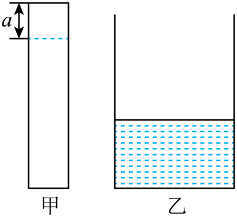

# Physics - 题目 1141

**ID**: 68470c5396b2460a9b7cfdc076df4090
**年级**: Grade 8
**难度**: Hard
**题型**: Fill-in-the-blank

## 题目
如图所示，圆柱体甲高60cm，底面积100cm^{2}，质量为3600g，足够高的容器乙底面积为300cm^{2}，内装有10cm深的水，则此时水对乙容器底的压强为Pa。​​​​​​​‌现将甲沿水平方向切去一部分，并将切下部分缓慢竖直放入容器乙中，此时甲剩余部分对桌面的压强和乙容器中水对底部的压强相等，再向乙中加入1000g水，切取部分在图乙中受到的浮力为N。

## 解答

1. [1]由题意得，乙容器中水的深度为
2. h_{水}=10cm=0.1m
3. 则此时水对乙容器底的压强为
4. $p=ρ{{}_{水}}gh{{}_{水}}=1.0\times 10{^{3}}{\rm{k}}{\rm{g}}{\rm{/}}{\rm{m}}{^{{\rm{3}}}}\times 10{\rm{N}}{\rm{/}}{\rm{k}}{\rm{g}}\times {\rm{0}}{\rm{.}}{\rm{1}}{\rm{m}}={\rm{1}}{\rm{0}}{\rm{0}}{\rm{0}}{\rm{P}}{\rm{a}}$
5. [2]由题意得，乙容器的底面积为
6. S_{乙}=300cm^{2}=3×10^{-2}m^{2}
7. 甲的底面积为
8. S_{甲}=100cm^{2}=1×10^{-2}m^{2}
9. 圆柱体甲高
10. h_{甲}=60cm=0.6m
11. 圆柱体甲的质量为
12. m_{甲}=3600g=3.6kg
13. 则圆柱体甲的体积为
14. $V{{}_{甲}}=S{{}_{甲}}h{{}_{甲}}=1.0\times 10{^{-2}}{\rm{m}}{^{2}}\times 0.6{\rm{m}}=6\times 10{^{-3}}{\rm{m}}{^{3}}$
15. 圆柱体甲的密度为
16. $ρ{{}_{甲}}=\frac {m{{}_{甲}}}{V{{}_{甲}}}=\frac {3.6{\rm{k}}{\rm{g}}}{6\times 10{^{-3}}{\rm{m}}{^{3}}}=0.6\times 10{^{3}}{\rm{k}}{\rm{g}}{\rm{/}}{\rm{m}}{^{{\rm{3}}}}$
17. 将甲沿水平方向切去长度为a，则剩余长度为h_{甲}-a，则剩余部分对桌面的压强为
18. $p{{}_{1}}=\frac {G{{}_{剩}}}{S{{}_{甲}}}=\frac {m{{}_{剩}}g}{S{{}_{甲}}}=\frac {ρ{{}_{甲}}S{{}_{甲}}g（h{{}_{甲}}-a)}{S{{}_{甲}}}=ρ{{}_{甲}}g（h{{}_{甲}}-a)$
19. 由以上分析可知， $ρ{{}_{甲}}<ρ{{}_{水}}$ ，当乙容器中水的体积足够大时，甲切去的部分在水中漂浮，当乙容器中水对甲切去部分提供的浮力小于甲切去部分的重力时，甲切去部分在水中沉底，下面需对这两种情况进行分类讨论：
20. 第一种情况，当切去部分在水中漂浮时，液面以下的体积增加值等与甲切去部分浸在水中的体V_{浸}，由 $V{{}_{浸}}=V{{}_{排}}$ 及漂浮时 $F{{}_{浮}}=G$ 得
21. $V{{}_{浸}}=V{{}_{排}}=\frac {F{{}_{浮}}}{ρ{{}_{水}}g}=\frac {G{{}_{切}}}{ρ{{}_{水}}g}=\frac {m{{}_{切}}g}{ρ{{}_{水}}g}=\frac {ρ{{}_{甲}}S{{}_{甲}}ag}{ρ{{}_{水}}g}=\frac {ρ{{}_{甲}}S{{}_{甲}}a}{ρ{{}_{水}}}$
22. 乙容器中液面上升的高度为
23. $Δh=\frac {V{{}_{浸}}}{S{{}_{乙}}}=\frac {ρ{{}_{甲}}S{{}_{甲}}a}{ρ{{}_{水}}S{{}_{乙}}}=\frac {0.6\times 10{^{3}}{\rm{k}}{\rm{g}}{\rm{/}}{\rm{m}}{^{{\rm{3}}}}\times 1\times 10{^{-2}}{\rm{m}}{^{2}}}{1.0\times 10{^{3}}{\rm{k}}{\rm{g}}{\rm{/}}{\rm{m}}{^{{\rm{3}}}}\times 3\times 10{^{-2}}{\rm{m}}{^{2}}}a=\frac {a}{5}$
24. 此时，乙容器中水对底部的压强为
25. $p{{}_{2}}=ρ{{}_{水}}g（h{{}_{水}}+Δh)=ρ{{}_{水}}g（h{{}_{水}}+\frac {a}{5})$
26. 由题意得，此时甲剩余部分对桌面的压强和乙容器中水对底部的压强相等，则有
27. $p{{}_{1}}=p{{}_{2}}$
28. $ρ{{}_{甲}}g（h{{}_{甲}}-a)=ρ{{}_{水}}g（h{{}_{水}}+\frac {a}{5})$
29. 则甲沿水平方向切去的长度为
30. $a=\frac {ρ{{}_{甲}}h{{}_{甲}}-ρ{{}_{水}}h{{}_{水}}}{\frac {1}{5}ρ{{}_{水}}+ρ{{}_{甲}}}=\frac {0.6\times 10{^{3}}{\rm{k}}{\rm{g}}{\rm{/}}{\rm{m}}{^{{\rm{3}}}}\times 0.6{\rm{m}}-1.0\times 10{^{3}}{\rm{k}}{\rm{g}}{\rm{/}}{\rm{m}}{^{{\rm{3}}}}\times 0.1{\rm{m}}}{\frac {1}{5}\times 1.0\times 10{^{3}}{\rm{k}}{\rm{g}}{\rm{/}}{\rm{m}}{^{{\rm{3}}}}+0.6\times 10{^{3}}{\rm{k}}{\rm{g}}{\rm{/}}{\rm{m}}{^{{\rm{3}}}}}=0.325{\rm{m}}$
31. 此时乙容器中液面高度为
32. $h=h{{}_{水}}+Δh=h{{}_{水}}+\frac {a}{5}=0.1{\rm{m}}+\frac {0.325{\rm{m}}}{5}=0.165{\rm{m}}$
33. 乙容器中放入甲切去部分后液面能达到的最大高度为
34. $h{{}_{{\rm \max }}}=\frac {V{{}_{水}}}{S{{}_{乙}}-S{{}_{甲}}}=\frac {S{{}_{乙}}h{{}_{水}}}{S{{}_{乙}}-S{{}_{甲}}}=\frac {3\times 10{^{-2}}{\rm{m}}{^{2}}\times 0.1{\rm{m}}}{3\times 10{^{-2}}{\rm{m}}{^{2}}-1\times 10{^{-2}}{\rm{m}}{^{2}}}=0.15{\rm{m}}$
35. 由以上分析可知，计算出的液面高度大于了乙容器中液面能达到的最大高度，即 $h>h{{}_{{\rm \max }}}$ ，计算结果与实际相矛盾，则甲切去部分在水中漂浮这种假设不成立。
36. 第二种情况，当切去部分在水中沉底时，由 $ρ{{}_{甲}}<ρ{{}_{水}}$ 可知，甲切去部分一定没有浸没，则此时夜面高度为乙容器中液面能达到的最大高度，即h_{max}=0.15m，此时水对乙容器底的压强为
37. $p{{}_{3}}=ρ{{}_{水}}gh{{}_{{\rm \max }}}=1.0\times 10{^{3}}{\rm{k}}{\rm{g}}{\rm{/}}{\rm{m}}{^{{\rm{3}}}}\times 10{\rm{N}}{\rm{/}}{\rm{k}}{\rm{g}}\times 0.15{\rm{m}}=1.5\times 10{^{3}}{\rm{P}}{\rm{a}}$
38. 由题意得，此时甲剩余部分对桌面的压强和乙容器中水对底部的压强相等，则有
39. $p{{}_{1}}=p{{}_{3}}$
40. $ρ{{}_{甲}}g（h{{}_{甲}}-a)=p{{}_{3}}$
41. 则甲沿水平方向切去的长度为
42. $a=h{{}_{甲}}-\frac {p{{}_{3}}}{ρ{{}_{甲}}g}=0.6{\rm{m}}-\frac {1.5\times 10{^{3}}{\rm{P}}{\rm{a}}}{0.6\times 10{^{3}}{\rm{k}}{\rm{g}}{\rm{/}}{\rm{m}}{^{{\rm{3}}}}\times 10{\rm{N}}{\rm{/}}{\rm{k}}{\rm{g}}}=0.35{\rm{m}}$
43. 若让切去部分恰好在水中漂浮，即甲切去部分底部刚要离开容器底，甲切去部分所受浮力为
44. $F{{}_{浮}}=G{{}_{切}}=m{{}_{切}}g=ρ{{}_{甲}}S{{}_{甲}}ag=0.6\times 10{^{3}}{\rm{k}}{\rm{g}}{\rm{/}}{\rm{m}}{^{{\rm{3}}}}\times 1\times 10{^{-2}}{\rm{m}}{^{2}}\times 0.35{\rm{m}}\times 10{\rm{N}}{\rm{/}}{\rm{k}}{\rm{g}}=21{\rm{N}}$
45. 甲切去部分排开液体的体积为
46. $V{{}_{排}}=\frac {F{{}_{浮}}}{ρ{{}_{液}}g}=\frac {21{\rm{N}}}{1.0\times 10{^{3}}{\rm{k}}{\rm{g}}{\rm{/}}{\rm{m}}{^{{\rm{3}}}}\times 10{\rm{N}}{\rm{/}}{\rm{k}}{\rm{g}}}=2.1\times 10{^{-3}}{\rm{m}}{^{3}}$
47. 液面高度为
48. $h{{}_{1}}=\frac {V{{}_{排}}}{S{{}_{甲}}}=\frac {2.1\times 10{^{-3}}{\rm{m}}{^{3}}}{1\times 10{^{-2}}{\rm{m}}{^{2}}}=0.21{\rm{m}}$
49. 液面较原来增加高度为
50. $Δh{{}_{1}}=h{{}_{1}}-h{{}_{{\rm \max }}}=0.21{\rm{m}}-0.15{\rm{m}}{\rm{=}}{\rm{0}}{\rm{.}}{\rm{0}}{\rm{6}}{\rm{m}}$
51. 让甲切去部分刚好漂浮，需加水的体积为
52. $V{{}_{需加}}=\left ({S{{}_{乙}}-S{{}_{甲}}}\right )Δh{{}_{1}}=\left ({3\times 10{^{-2}}{\rm{m}}{^{2}}-1\times 10{^{-2}}{\rm{m}}{^{2}}}\right )\times 0.06{\rm{m}}={\rm{1}}{\rm{.}}{\rm{2}}\times 10{^{-3}}{\rm{m}}{^{3}}$
53. 需加水的质量为
54. $m{{}_{需加}}=ρ{{}_{水}}V{{}_{需加}}=1.0\times 10{^{3}}{\rm{k}}{\rm{g}}{\rm{/}}{\rm{m}}{^{{\rm{3}}}}\times 1.2\times 10{^{-3}}{\rm{m}}{^{3}}={\rm{1}}{\rm{.}}{\rm{2}}{\rm{k}}{\rm{g}}$
55. 故再加入1000g水时，甲切去部分切去不能漂浮，仍然处于沉底状态，实际加入水的体积为
56. $V{{}_{实加}}=\frac {m{{}_{实加}}}{ρ{{}_{水}}}=\frac {1{\rm{k}}{\rm{g}}}{1.0\times 10{^{3}}{\rm{k}}{\rm{g}}{\rm{/}}{\rm{m}}{^{{\rm{3}}}}}=1\times 10{^{-3}}{\rm{m}}{^{3}}$
57. 此时液面高度增加
58. $Δh{{}_{2}}=\frac {V{{}_{{{}_{实加}}}}}{S{{}_{乙}}-S{{}_{甲}}}=\frac {1\times 10{^{-3}}{\rm{m}}{^{3}}}{3\times 10{^{-2}}{\rm{m}}{^{2}}-1\times 10{^{-2}}{\rm{m}}{^{2}}}=0.05{\rm{m}}$
59. 此时，甲切去部分排开水的体积为
60. $V^{′}{{{}_{排}}}=S{{}_{甲}}\left ({h{{}_{{\rm \max }}}+Δh{{}_{2}}}\right )=1\times 10{^{-2}}{\rm{m}}{^{2}}\times \left ({0.15{\rm{m}}+0.05{\rm{m}}}\right )=2\times 10{^{-3}}{\rm{m}}{^{3}}$
61. 切去部分受到的浮力为
62. $F{{}_{浮}}=ρ{{}_{水}}gV^{′}{{{}_{排}}}=1.0\times 10{^{3}}{\rm{k}}{\rm{g}}{\rm{/}}{\rm{m}}{^{{\rm{3}}}}\times 10{\rm{N}}{\rm{/}}{\rm{k}}{\rm{g}}\times 2\times 10{^{-3}}{\rm{m}}{^{3}}=20{\rm{N}}$
63. 综上分析可知，将甲沿水平方向切去一部分，并将切下部分缓慢竖直放入容器乙中，满足甲剩余部分对桌面的压强和乙容器中水对底部的压强相等的条件且与实际相符，甲切去部分应在水中沉底，甲切去的长度应为0.35m，再向乙中加入1000g水，切取部分在乙容器中受到的浮力为20N。

## 知识点

**中文**:
  - 密度、压强和浮力的综合

**English**:
  - Integrated Density, Pressure, and Buoyancy

---
