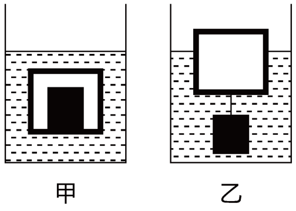

# Physics - 题目 624

**ID**: aa8e42dee8f148508e75952405348701
**年级**: Grade 8
**难度**: Hard
**题型**: Fill-in-the-blank

## 题目
如图甲所示，用同种合金制成质量相等的空心金属盒、实心金属块各一个，把金属块放在盒内密封后，它们恰好能悬浮在水中。​​​​​​​‌如图乙所示，把金属块和金属盒用细绳相连，放入水中静止时，金属盒有 $\frac {1}{5}$ 体积露出水面，此时细绳对金属块的拉力为15N，则这种实心金属块的体积是m^{3}，若金属盒内部装水，则金属盒的最大总重是N。

## 解答

1. [1][2]由图甲知，空心金属盒悬浮在水中，那么
2. V_{金属盒}=V_{排}_{1}
3. 设空心金属盒和实心金属块的重力都为G，则有
4. F_{浮}_{1}=ρ_{水}gV_{排}_{1}=ρ_{水}gV_{金属盒}=2G
5. 此为①式；
6. 由图乙知，金属盒漂浮在水中，且
7. $\frac {4}{5}$V_{金属盒}=V_{排}_{2}
8. 金属盒此时受到重力、浮力和拉力的作用，所以
9. F_{浮}_{2}=ρ_{水}gV_{排}_{2}=ρ_{水}g⋅ $\frac {4}{5}$V_{金属盒}=G+F_{拉}
10. 即
11. 2G⋅ $\frac {4}{5}$ =G+15N
12. 解得
13. G=25N
14. 将G=25N代入①式，有
15. 1.0×10^{3}kg/m^{3}×10N/kg⋅V_{金属盒}=2×25N
16. 解得
17. V_{金属盒}=5×10^{-3}m^{3}
18. 图乙中，实心金属块浸没在水中，则
19. V_{排}_{3}=V_{金属}_{块}
20. 金属块受到：重力、拉力和浮力的作用，处于静止，则有
21. F_{浮}_{3}+F_{拉}=G
22. 所以
23. 1.0×10^{3}kg/m^{3}×10N/kg⋅V_{金属}_{块}+15N=25N
24. 解得
25. V_{金属}_{块}=1×10^{-3}m^{3}
26. 金属盒是有厚度的，组成其材料的体积和金属块的体积相同也是1×10^{-3}m^{3}，金属盒的容积
27. V_{容}=V_{金属盒}-V_{材}=5×10^{-3}m^{3}-1×10^{-3}m^{3}=4×10^{-3}m^{3}
28. 金属盒内装满水，水的重力
29. G_{水}=mg=ρ_{水}V_{容}g=1.0×10^{3}kg/m^{3}×4×10^{-3}m^{3}×10N/kg=40N
30. 此时，金属盒的总重最大为
31. G_{总}=G+G_{水}=25N+40N=65N

## 知识点

**中文**:
  - 物体的浮沉条件及其应用
  - 阿基米德原理的应用

**English**:
  - Floating/Sinking Conditions and Applications
  - Applications of Archimedes' Principle

---
