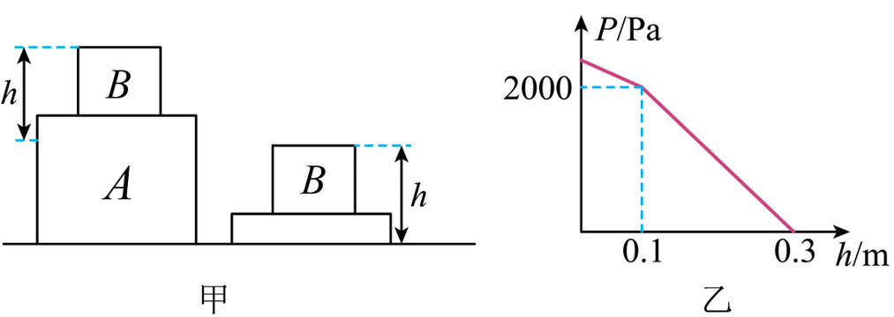

# Physics - 题目 223

**ID**: 1e1310f4966b439ba656a41dc4a51285
**年级**: Grade 8
**难度**: Hard
**题型**: Multiple-choice

## 题目
如图甲所示，A、B是质量分布均匀的圆柱体，沿水平方向从该模型上方切去一定高度并将切去部分平放在同一水平面上，该模型剩余部分对地面的压强p随切去高度h变化的图像如图乙所示。​​​​​​​‌已知A、B的底面积分别为400cm^{2}和100cm^{2}，B的质量为3.2kg，下列说法正确的是（      ）

## 解答

1. 由图乙可知，B的高度为0.1m，A的高度为0.2m，当B全部切除，只剩下A，A对地面的压强为2000 Pa，则A对地面的压力 $F{{}_{A}}=p{{}_{A}}S{{}_{A}}=2000{\rm{P}}{\rm{a}}\times 400\times 10{^{-4}}{\rm{m}}{^{2}}=80{\rm{N}}$ ，则A的重力 $G{{}_{A}}=F{{}_{A}}=80{\rm{N}}{\rm ，\mathit{A}}$ 的体积 $V{{}_{A}}=S{{}_{A}}h{{}_{A}}=400\times 10{^{-4}}{\rm{m}}{^{2}}\times 0.2{\rm{m}}=8\times 10{^{-3}}{\rm{m}}{^{{{3}}}}{\rm ，\mathit{A}}$ 的密度 $ρ{{}_{A}}=\frac {m{{}_{A}}}{V{{}_{A}}}=\frac {\frac {G{{}_{A}}}{g}}{V{{}_{A}}}=\frac {\frac {80{\rm{N}}}{10{\rm{N}}{\rm{/}}{\rm{k}}{\rm{g}}}}{8\times 10{^{-3}}{\rm{m}}{^{{{3}}}}}=1\times 10{^{3}}{\rm{k}}{\rm{g}}/{\rm{m}}{^{{{3}}}}$ ，故A错误；A和B总高度为0.3m，当该模型切去部分的高度和剩余部分的高度相同时，切掉的高度为0.15m，因B高0.1m，则切掉的A的高度为0.05m，切掉的A的重力 $G{{}_{A1}}=m{{}_{A1}}g=ρ{{}_{A}}S{{}_{A}}h{{}_{A1}}g=1\times 10{^{3}}{\rm{k}}{\rm{g}}/{\rm{m}}{^{{{3}}}}\times 400\times 10{^{-4}}{\rm{m}}{^{2}}\times 0.05{\rm{m}}\times 10{\rm{N}}{\rm{/}}{\rm{k}}{\rm{g}}=20{\rm{N}}{\rm ，\mathit{B}}$ 的重力 $G{{}_{B}}=m{{}_{B}}g=3.2{\rm{k}}{\rm{g}}\times 10{\rm{N}}{\rm{/}}{\rm{k}}{\rm{g}}=32{\rm{N}}$ ，切掉部分的总重力 $G{{}_{总}}=G{{}_{A1}}+G{{}_{B}}=20{\rm{N}}+32{\rm{N}}=52{\rm{N}}$ ，切去部分对地面的压强 $p{{}_{1}}=\frac {F{{}_{1}}}{S{{}_{A}}}=\frac {G{{}_{总}}}{S{{}_{A}}}=\frac {52{\rm{N}}}{400\times 10{^{-4}}{\rm{m}}{^{2}}}=1300{\rm{P}}{\rm{a}}$ ，故B错误；若B全部切除，则B对地面的压强 $p{{}_{B}}=\frac {F{{}_{B}}}{S{{}_{B}}}=\frac {G{{}_{B}}}{S{{}_{B}}}=\frac {3.2{\rm{k}}{\rm{g}}\times 10{\rm{N}}{\rm{/}}{\rm{k}}{\rm{g}}}{100\times 10{^{-4}}{\rm{m}}{^{2}}}=3200{\rm{P}}{\rm{a}}>2000{\rm{P}}{\rm{a}}$ ，不符合题意。因此可能只切除一部分B，也可能切除全部B和部分A。当只切除一部分B时，切去部分对地面的压强与剩余部分对地面的压强相等，则 $p{{}_{切}}=p{{}_{剩}}$ ，即 $\frac {G{{}_{B}}\times \frac {h{{}_{B切}}}{h{{}_{B}}}}{S{{}_{B}}}=\frac {G{{}_{A}}+G{{}_{B}}\frac {h{{}_{B}}-h{{}_{B切}}}{h{{}_{B}}}}{S{{}_{A}}}$ ，将 $G{{}_{B}}=32{\rm{N}}$ ， $G{{}_{A}}=80{\rm{N}}$ ， $S{{}_{A}}=400\times 10{^{-4}}{\rm{m}}{^{2}}$ ， $S{{}_{B}}=100\times 10{^{-4}}{\rm{m}}{^{2}}$ ， $h{{}_{B}}=0.1{\rm{m}}$
2. 代入上式，解得 $h{{}_{B切}}=0.07{\rm{m}}$ 。切除部分体积 $V{{}_{1}}=S{{}_{B}}h{{}_{切B}}=100{\rm{c}}{\rm{m}}{^{2}}\times 7{\rm{c}}{\rm{m}}=700{\rm{c}}{\rm{m}}{^{{{3}}}}$ ，若切除全部B和部分A，则切除部分和剩余部分与地面的接触面积相同，都为 $S{{}_{A}}$ ，由 $p=\frac {F}{S}$ 可知，切除部分和剩余部分对地面的压力相同，重力相同。切除部分重力 $G{{}_{切}}=G{{}_{B}}+G{{}_{A切}}=32{\rm{N}}+ρ{{}_{{{}_{A}}}}S{{}_{A}}h{{}_{A切}}g=32{\rm{N}}+10{^{3}}{\rm{k}}{\rm{g}}/{\rm{m}}{^{{{3}}}}\times 400\times 10{^{-4}}{\rm{m}}{^{2}}\times h{{}_{A切}}\times 10{\rm{N}}{\rm{/}}{\rm{k}}{\rm{g}}$ ①，剩余部分重力 $G{{}_{剩余}}=ρ{{}_{A}}S{{}_{A}}\left ({h{{}_{A}}-h{{}_{A切}}}\right )g=10{^{3}}{\rm{k}}{\rm{g}}/{\rm{m}}{^{{{3}}}}\times 400\times 10{^{-4}}{\rm{m}}{^{2}}\times \left ({0.2{\rm{m}}-h{{}_{A切}}}\right )\times 10{\rm{N}}{\rm{/}}{\rm{k}}{\rm{g}}$ ②，因 $G{{}_{切}}=G{{}_{剩余}}$ ③，则联立①②③公式解得 $h{{}_{A切}}=0.06{\rm{m}}$ 。则切除部分的体积 $V{{}_{2}}=V{{}_{B}}+V{{}_{{\rm{A}}切}}=100\times 10{^{-4}}{\rm{m}}{^{2}}\times 0.1{\rm{m}}+400\times 10{^{-4}}{\rm{m}}{^{2}}\times 0.06{\rm{m}}=3.4\times 10{^{-3}}{\rm{m}}{^{{{3}}}}=3400{\rm{c}}{\rm{m}}{^{{{3}}}}$
3. 则切除部分体积可能为 $700{\rm{c}}{\rm{m}}{^{{{3}}}}$ 和 $3400{\rm{c}}{\rm{m}}{^{{{3}}}}$ ，故C正确；若只将B沿水平方向切去四分之一，则剩余部分对地面的压强 $p{{}_{剩余1}}=\frac {G{{}_{A}}+\frac {3}{4}G{{}_{B}}}{S{{}_{A}}}=\frac {80{\rm{N}}+\frac {3}{4}\times 32{\rm{N}}}{400\times 10{^{-4}}{\rm{m}}{^{2}}}=2600{\rm{P}}{\rm{a}}$ ，只将A沿竖直方向切去四分之一，则剩余部分对地面的压强 $p{{}_{剩余2}}=\frac {\frac {3}{4}G{{}_{A}}+G{{}_{B}}}{\frac {3}{4}S{{}_{A}}}=\frac {\frac {3}{4}\times 80{\rm{N}}{{+}}{{3}}{{2}}{\rm{N}}}{\frac {3}{4}\times 400\times 10{^{-4}}{\rm{m}}{^{2}}}=\frac {92}{3}\times 10{^{2}}{\rm{P}}{\rm{a}}$ ，剩余部分对地面的压强之比 $\frac {p{{}_{剩余1}}}{p{{}_{剩余2}}}=\frac {2600{\rm{P}}{\rm{a}}}{\frac {9200}{3}{\rm{P}}{\rm{a}}}=\frac {78}{92}=\frac {39}{46}$ ，故D错误。

## 知识点

**中文**:
  - 固体压强的判断与计算

**English**:
  - Determination and Calculation of Solid Pressure

---
