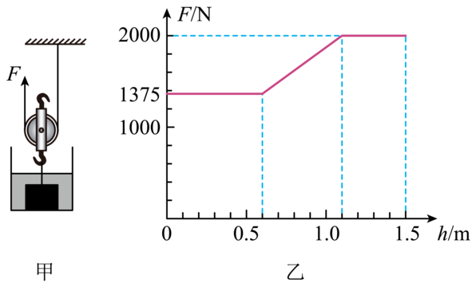

# Physics - 题目 2459

**ID**: 73adc13e5aca4cbd95f4787778faf6fc
**年级**: Grade 8
**难度**: Hard
**题型**: Multiple-choice

## 题目
如图甲所示，用动滑轮将正方体物块从装有水的容器底部缓慢匀速提起，拉力F随提升高度h变化的关系如图乙所示。​​​​​​​‌物块完全离开水面后，动滑轮的机械效率为 87.5%， 绳重和摩擦忽略不计，下列说法中正确的是（      ）①物块的边长为 0.5m②动滑轮重为 300N③提升物块完全离开水面前，动滑轮的机械效率大于87.5%④将物块提升至上表面与水面相平的过程中拉力F做的功为1650J

## 解答

1. ①动滑轮绳子的有效股数n=2，由图乙知道，物块浸没时绳子的拉力F_{1}=1375N，绳重和摩擦忽略不计，由 $F=\frac {1}{n}\left ({G{{}_{物}}+G{{}_{动}}-F{{}_{浮}}}\right )$ 知道
2. $1375{\rm{N}}{\rm{=}}\frac {1}{2}\left ({G{{}_{物}}+G{{}_{动}}-F{{}_{浮}}}\right )$ ---①
3. 当物块完全离开水面后绳子的拉力F_{2}=2000N，由 $F=\frac {1}{n}\left ({G{{}_{物}}+G{{}_{动}}}\right )$ 知道，
4. $2000{\rm{N}}{\rm{=}}\frac {1}{2}\left ({G{{}_{物}}+G{{}_{动}}}\right )$ -----②
5. 由①②解得
6. F_{浮}=1250N
7. 因物体浸没时排开液体的体积和自身的体积相等，所以，由F_{浮}=ρ_{液}gV_{排}知道，物块的体积
8. $V=V{{}_{排}}=\frac {F{{}_{浮}}}{ρ{{}_{水}}g}{\rm{=}}\frac {1250N}{1.0\times 10{^{3}}{\rm{k}}{\rm{g}}{\rm{/}}{\rm{m}}{^{3}}\times 10{\rm{N}}{\rm{/}}{\rm{k}}{\rm{g}}}=0.125{\rm{m}}{^{3}}$
9. 由V=L^{3}知道，物块的边长
10. $L=\sqrt[3]{0.125{\rm{m}}{^{3}}}{\rm{=}}0.5{\rm{m}}$
11. 故①正确；
12. ②绳重和摩擦忽略不计，物块完全离开水面后，动滑轮的机械效率
13. $η=\frac {W{{}_{有}}}{W{{}_{总}}}{\rm{=}}\frac {W{{}_{有}}}{W{{}_{有}}+W{{}_{额外}}}{\rm{=}}\frac {Gh}{Gh+G{{}_{动}}h}{\rm{=}}\frac {G}{G+G{{}_{动}}}$
14. 即
15. $87.5{\rm{\%}}{\rm{=}}\frac {G}{G+G{{}_{动}}}$ -----③
16. 由②③解得
17. G=3500N
18. G_{动}=500N
19. 故②错误；
20. ③绳重和摩擦忽略不计，提升物块完全离开水面前，动滑轮的机械效率
21. $η=\frac {W{{}_{有}}}{W{{}_{总}}}{\rm{=}}\frac {W{{}_{有}}}{W{{}_{有}}+W{{}_{额外}}}{\rm{=}}\frac {\left ({G-F{{}_{浮}}}\right )h}{\left ({G-F{{}_{浮}}}\right )h+G{{}_{动}}h}{\rm{=}}\frac {\left ({G-F{{}_{浮}}}\right )}{\left ({G-F{{}_{浮}}}\right )+G{{}_{动}}}{\rm{=}}\frac {{\rm{3}}{\rm{5}}{\rm{0}}{\rm{0}}{\rm{N}}{\rm{-}}{\rm{1}}{\rm{2}}{\rm{5}}{\rm{0}}{\rm{N}}}{{\rm{3}}{\rm{5}}{\rm{0}}{\rm{0}}{\rm{N}}{\rm{-}}{\rm{1}}{\rm{2}}{\rm{5}}{\rm{0}}{\rm{N}}{\rm{+}}{\rm{5}}{\rm{0}}{\rm{0}}{\rm{N}}}\approx 81.8\%$
22. 则动滑轮的机械效率小于87.5%，故③错误；
23. ④将物块提升至上表面与水面相平的过程中，由图乙知道，物体上升的高度h=0.6m，拉力F=1375N，绳子自由端移动的距离
24. s=nh=2×0.6m=1.2m
25. 此过程中拉力F做的功
26. W=Fs=1375N×1.2m=1650J
27. 故④正确；
28. 故A正确。
29. 故选A。

## 知识点

**中文**:
  - 功的计算和估算
  - 阿基米德原理的应用
  - 动滑轮拉力的计算
  - 滑轮（组）的机械效率及其计算

**English**:
  - Calculation and Estimation of Work
  - Applications of Archimedes' Principle
  - Calculating Pulling Force of Movable Pulleys
  - Mechanical Efficiency of Pulleys and Calculations

---
