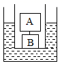

# Physics - 题目 1887

**ID**: 7cc8744504fb4beba96500654736029f
**年级**: Grade 8
**难度**: Hard
**题型**: Multiple-choice

## 题目
如图，有A、B两个物体，用弹簧连接后置于烧杯内，再将烧杯放入装有足够多的水的容器中，静止后如图所示。​​​​​​​‌已知A为正方体，重力为8N；B为体积200cm^{3}，高4cm的柱体，重力5N；烧杯底面积为200cm^{2}，容器底面积为250cm^{2}，且弹簧弹力每改变1N，长度改变0.8cm。现将A、B从烧杯中取出放入水中，静止后，弹簧与图示状态相比伸长了8cm，下列说法正确的是（      ）

## 解答

1. A．B底面积为
2. $S{{}_{{\rm{B}}}}=\frac {V{{}_{{\rm{B}}}}}{h{{}_{{\rm{B}}}}}=\frac {200{\rm{c}}{\rm{m}}{^{3}}}{4{\rm{c}}{\rm{m}}}=50{\rm{c}}{\rm{m}}{^{2}}$
3. 如图所示状态，B物体对烧杯底的压强为
4. $p=\frac {G{{}_{{\rm{A}}}}+G{{}_{{\rm{B}}}}}{S{{}_{{\rm{B}}}}}=\frac {8{\rm{N}}+5{\rm{N}}}{50\times 10{^{-4}}{\rm{m}}{^{2}}}=2{\rm{.}}6\times 10{^{3}}{\rm{P}}{\rm{a}}$
5. 故A错误。
6. BD．原先烧杯漂浮，浮力等于总重力，AB受到的浮力
7. F_{浮}_{1}=G_{A}+G_{B}=8N+5N=13N
8. 将A、B放入水中静止后，弹簧与图示状态相比伸长了8cm，弹簧弹力每改变1N，长度改变0.8cm，所以弹力变化了10N，因为原先弹簧压缩，弹力为8N，所以现在弹簧伸长，弹力为2N，受力分析可知，A受到浮力为
9. F_{浮}_{A}=2N+8N=10N
10. B最大浮力为
11. F_{浮}_{B}=ρgV_{B}=10^{3}kg/m^{3}×10N/kg×200×10^{-6}m^{3}=2N
12. 总浮力
13. F_{浮}_{2}=F_{浮}_{A}+F_{浮}_{B}=10N+2N=12N
14. 总浮力变化量
15. ΔF_{浮}=F_{浮}_{1}-F_{浮}_{2}=13N-12N=1N
16. 由浮力产生原因可知，水对烧杯底部的压力减小了1N，水对烧杯底部的压强减小
17. ${\rm{Δ}}p=\frac {{\rm{Δ}}F{{}_{浮}}}{S{{}_{1}}}=\frac {1{\rm{N}}}{200\times 10{^{-4}}{\rm{m}}{^{2}}}=50{\rm{P}}{\rm{a}}$
18. B受浮力2N，弹力2N，重力5N，所以还受支持力1N，所以一定沉底了，所以A应该完全浸没，A体积为
19. $V{{}_{{\rm{A}}}}=\frac {F}{ρg}=\frac {10{\rm{N}}}{10{^{3}}{\rm{k}}{\rm{g}}{\rm{/}}{\rm{m}}{^{3}}\times 10{\rm{N}}{\rm{/}}{\rm{k}}{\rm{g}}}=10{^{-3}}{\rm{m}}{^{3}}$
20. A密度为
21. $ρ{{}_{{\rm{A}}}}=\frac {m{{}_{{\rm{A}}}}}{V{{}_{{\rm{A}}}}}=\frac {G{{}_{{\rm{A}}}}}{gV{{}_{{\rm{A}}}}}=\frac {8{\rm{N}}}{10{\rm{N}}{\rm{/}}{\rm{k}}{\rm{g}}\times 10{^{-3}}{\rm{m}}{^{3}}}=0.8\times 10{^{3}}{\rm{k}}{\rm{g}}{\rm{/}}{\rm{m}}{^{3}}$
22. 故D正确，B错误；
23. C．将一些水带入烧杯中，与开始相比浮力增大量为带入水重力，根据F_{浮}=ρgV_{排}，V_{排}增大量其实就是带入水体积，所以水位不变，故C错误；
24. 故选D。

## 知识点

**中文**:
  - 压强的计算
  - 密度公式的应用
  - 液体压强的判断与计算
  - 阿基米德原理的应用
  - 密度、压强和浮力的综合

**English**:
  - Calculation of Pressure
  - Application of Density Formula
  - Determination and Calculation of Liquid Pressure
  - Applications of Archimedes' Principle
  - Integrated Density, Pressure, and Buoyancy

---
