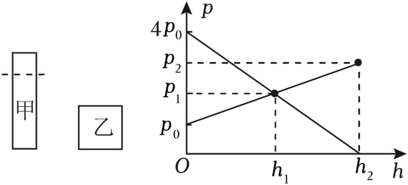

# Physics - 题目 2604

**ID**: c024201bdb754f4490b08fcf5990aac1
**年级**: Grade 8
**难度**: Hard
**题型**: Multiple-choice

## 题目
如图所示，甲、乙两个实心物体静止在水平面上，甲为底面积为0.25m^{2}、高5m的均匀柱状体，乙为边长为1m的正方体。​​​​​​​‌当沿水平方向截取不同高度的甲物体，并平放在乙物体正上方，甲、乙对地面的压强随截取的高度h的变化如图所示，则下列说法错误的是（      ）

## 解答

1. A．当沿水平方向截取不同高度的甲物体，并平稳的放在乙物体上时，甲剩余的质量减小，对地面的压力减小，受力面积不变，由 $p=\frac {F}{S}$ 可知，甲对地面的压强减小，乙对地面的压强增大，由图可知，P随h的增大而减小的图像，为甲的压强随截取的高度h的变化的关系，P随h的增大而增大的图像，为乙的压强随截取的高度h的变化的关系。根据
2. $p=\frac {F}{S}=\frac {G}{S}=\frac {mg}{S}=\frac {ρgV}{S}=\frac {ρgSh}{s}=ρgh$ ，知甲与乙的密度之比为 $\frac {ρ{{}_{甲}}}{ρ{{}_{乙}}}=\frac {\frac {P{{}_{甲}}}{gh{{}_{甲}}}}{\frac {P{{}_{乙}}}{gh{{}_{乙}}}}=\frac {P{{}_{甲}}}{P{{}_{乙}}}\times \frac {h{{}_{甲}}}{h{{}_{乙}}}=\frac {4P{{}_{0}}}{P{{}_{0}}}\times \frac {1{\rm{m}}}{5{\rm{m}}}=\frac {4}{5}$ ，则甲、乙密度之比为4︰5，故A正确，不符合题意；
3. B．由图可知，甲截取高度为h_{1}时，甲剩余部分对地面的压强与叠加后乙对地面的压强相等，则有 $\frac {G{{}_{甲}}-ΔG}{S{{}_{甲}}}=\frac {G{{}_{乙}}+ΔG}{S{{}_{乙}}}$ ， $\frac {ρ{{}_{甲}}gS{{}_{甲}}h{{}_{甲}}-ρ{{}_{甲}}gS{{}_{甲}}h{{}_{1}}}{S{{}_{甲}}}=\frac {ρ{{}_{乙}}gS{{}_{乙}}h{{}_{乙}}+ρ{{}_{乙}}gS{{}_{乙}}h{{}_{1}}}{S{{}_{乙}}}$ ，已知ρ_{甲}︰ρ_{乙}＝4︰5，即ρ_{乙}＝ $\frac {5}{4}$ρ_{甲}_{，}化简后可得 $h{{}_{甲}}﹣h{{}_{1}}=\frac {5}{4}h{{}_{乙}}+\frac {5}{4}h{{}_{1}}$ ，解得 $h{{}_{1}}=3{\rm{m}}$ ，则h_{1}︰h_{2}＝3m︰5m＝3︰5，故B正确，不符合题意；
4. C．P_{1}与P_{2}之比为 $\frac {P{{}_{1}}}{P{{}_{2}}}=\frac {ρ{{}_{甲}}g\left ({h{{}_{甲}}-h{{}_{1}}}\right )}{\frac {G{{}_{甲}}+G{{}_{乙}}}{S{{}_{乙}}}}=\frac {ρ{{}_{甲}}g\left ({h{{}_{甲}}-h{{}_{1}}}\right )}{\frac {ρ{{}_{甲}}gS{{}_{甲}}h{{}_{甲}}+ρ{{}_{乙}}gS{{}_{乙}}h{{}_{乙}}}{S{{}_{乙}}}}=\frac {h{{}_{甲}}-h{{}_{1}}}{\frac {S{{}_{甲}}}{S{{}_{乙}}}\times h{{}_{甲}}+\frac {5}{4}h{{}_{乙}}}=\frac {5{\rm{m}}-3{\rm{m}}}{\frac {0.25{\rm{m}}{^{2}}}{1{\rm{m}}{^{2}}}\times 5{\rm{m}}+\frac {5}{4}\times 1{\rm{m}}}=\frac {4}{5}$ ，故C错误，符合题意；
5. D．P_{1}和P_{0}的比值为 $\frac {P{{}_{1}}}{P{{}_{0}}}=\frac {ρ{{}_{甲}}g\left ({h{{}_{甲}}-h{{}_{1}}}\right )}{ρ{{}_{乙}}gh{{}_{乙}}}=\frac {4\times \left ({5{\rm{m}}-3{\rm{m}}}\right )}{5\times 1{\rm{m}}}=1.6$ ，所以 $P{{}_{1}}=1.6P{{}_{0}}$ ，故D正确，不符合题意。
6. 故选C。

## 知识点

**中文**:
  - 压强的计算

**English**:
  - Calculation of Pressure

---
