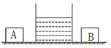

# Physics - 题目 436

**ID**: cd8c78d621434a488ae4b4189fa68081
**年级**: Grade 8
**难度**: Hard
**题型**: Multiple-choice

## 题目
如图所示，水平面上有一底面积200cm^{2}，高12cm的圆柱形薄壁容器，容器中装有质量为2kg的水。​​​​​​​‌现将一个质量分布均匀，底面积100cm^{2}，体积500cm^{3}的物体A（不吸水）放入容器中，A漂浮在水面上，且浸入水中的体积为总体积的 $\frac {2}{5}$ 。再在A的上方放一个物体B，使A刚好浸没于水中（B不浸入）。则下列说法正确的是（      ）

## 解答

1. A．由题意可知，物体A的体积为
2. $V{{}_{{\rm{A}}}}=500{\rm{c}}{\rm{m}}{^{3}}=5\times 10{^{-4}}{\rm{m}}{^{3}}$
3. A漂浮在水面上时，浸入水中的体积为总体积的五分之二，故由阿基米德原理可得，A受到水的浮力为
4. $F{{}_{浮}}=ρ{{}_{水}}gV{{}_{排}}=1\times 10{^{3}}{\rm{k}}{\rm{g}}/{\rm{m}}{^{3}}\times 10{\rm{N}}/{\rm{k}}{\rm{g}}\times \frac {2}{5}\times 5\times 10{^{-4}}{\rm{m}}{^{3}}=2{\rm{N}}$
5. 因物体A受力平衡，故物体A的重力
6. G_{A}=F_{浮}=2N
7. 得到物体A的密度为
8. $ρ{{}_{{\rm{A}}}}=\frac {m{{}_{{\rm{A}}}}}{V{{}_{{\rm{A}}}}}=\frac {G{{}_{{\rm{A}}}}}{gV{{}_{{\rm{A}}}}}=\frac {2{\rm{N}}}{10{\rm{N}}/{\rm{k}}{\rm{g}}\times 5\times 10{^{-4}}{\rm{m}}{^{3}}}=0.4\times 10{^{3}}{\rm{k}}{\rm{g}}/{\rm{m}}{^{3}}=0.4{\rm{g}}/{\rm{c}}{\rm{m}}{^{3}}$
9. 故A错误；
10. B．再将物体B放入后，将A、B看成一个整体，此时整体排开水的体积为V_{A}=5 $\times $ 10^{-4}m³，故此时整体所受浮力为
11. $F=ρ{{}_{水}}gV{{}_{{\rm{A}}}}=1\times 10{^{3}}{\rm{k}}{\rm{g}}/{\rm{m}}{^{3}}\times 10{\rm{N}}/{\rm{k}}{\rm{g}}\times 5\times 10{^{-4}}{\rm{m}}{^{3}}=5{\rm{N}}$
12. 因此时整体处于漂浮状态，故整体的重力为
13. G=F=5N
14. 又因物体A的重力为G_{A}=2N，故物体B的重力为
15. G_{B}=G-G_{A}=5N-2N=3N
16. 故物体B的质量为
17. $m{{}_{{\rm{B}}}}=\frac {G{{}_{{\rm{B}}}}}{g}=\frac {3{\rm{N}}}{10{\rm{N}}/{\rm{k}}{\rm{g}}}=0.3{\rm{k}}{\rm{g}}=300{\rm{g}}$
18. 故B错误；
19. C．由题意可知物体A从漂浮到刚好浸没，浸入水中的体积变化量为
20. ${\rm{Δ}}V=\frac {3}{5}V{{}_{{\rm{A}}}}=\frac {3}{5}\times 500{\rm{c}}{\rm{m}}{^{3}}=300{\rm{c}}{\rm{m}}{^{3}}$
21. 故物体A浸入水中的深度变化量为
22. ${\rm{Δ}}h=\frac {{\rm{Δ}}V}{S{{}_{{\rm{A}}}}}=\frac {300{\rm{c}}{\rm{m}}{^{3}}}{100{\rm{c}}{\rm{m}}{^{2}}}=3{\rm{c}}{\rm{m}}$
23. 而水面高度变化量为
24. $h{{}_{水}}=\frac {{\rm{Δ}}V}{S{{}_{容}}}=\frac {300{\rm{c}}{\rm{m}}{^{3}}}{200{\rm{c}}{\rm{m}}{^{2}}}=1.5{\rm{c}}{\rm{m}}$
25. 故物体A下降的距离是
26. $h={\rm{Δ}}h-h{{}_{水}}=3{\rm{c}}{\rm{m}}-1.5{\rm{c}}{\rm{m}}=1.5{\rm{c}}{\rm{m}}$
27. 故C正确；
28. D．由C中可知，物体A从漂浮到刚好浸没，水面上升的高度为
29. $h{{}_{水}}=1.5{\rm{c}}{\rm{m}}=0.015{\rm{m}}$
30. 故水对容器底部增大的压力为
31. ${\rm{Δ}}F={\rm{Δ}}pS{{}_{容}}=ρ{{}_{水}}gh{{}_{水}}S{{}_{容}}=1\times 10{^{3}}{\rm{k}}{\rm{g}}/{\rm{m}}{^{3}}\times 10{\rm{N}}/{\rm{k}}{\rm{g}}\times 0.015{\rm{m}}\times 0.02{\rm{m}}{^{2}}=3{\rm{N}}$
32. 故D错误。
33. 故选C。

## 知识点

**中文**:
  - 密度、压强和浮力的综合

**English**:
  - Integrated Density, Pressure, and Buoyancy

---
