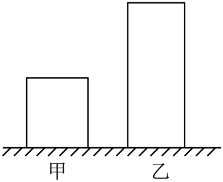

# Physics - 题目 2021

**ID**: d057c552c0524b28a210479ded85da7c
**年级**: Grade 8
**难度**: Hard
**题型**: Multiple-choice

## 题目
如图所示，甲、乙是放在水平地面上的两个质量均匀的长方体，它们的密度之比ρ_{甲}:ρ_{乙}=5:4，底面积之比S_{甲}:S_{乙}=6:5，对水平地面的压强之比p_{甲}:p_{乙}=3:4，下列说法错误的是（      ）​​​​​​​‌

## 解答

1. A．根据题意甲、乙两个长方体底面积之比S_{甲}:S_{乙}=6:5，即 $S{{}_{乙}}=\frac {5}{6}S{{}_{甲}}$ ，对水平地面的压强之比p_{甲}:p_{乙}=3:4，即 $p{{}_{乙}}=\frac {4}{3}p{{}_{甲}}$ ，由公式 $p=\frac {F}{S}$ 可知，甲乙对水平地面的压力分别为
2. $F{{}_{甲}}=p{{}_{甲}}S{{}_{甲}}$
3. $F{{}_{乙}}=p{{}_{乙}}S{{}_{乙}}=\frac {4}{3}p{{}_{甲}}\times \frac {5}{6}S{{}_{甲}}=\frac {10}{9}p{{}_{甲}}S{{}_{甲}}$
4. 根据单独一个物体放在水平面上时，物体对水平面的压力等于物体的重力可得， $F{{}_{甲}}=G{{}_{甲}}$ ， $F{{}_{乙}}=G{{}_{乙}}$ ，由公式 $G=mg$ 可知，甲、乙的质量分别为
5. $m{{}_{甲}}=\frac {G{{}_{甲}}}{g}=\frac {p{{}_{甲}}S{{}_{甲}}}{g}$
6. $m{{}_{乙}}=\frac {G{{}_{乙}}}{g}=\frac {\frac {10}{9}p{{}_{甲}}S{{}_{甲}}}{g}=\frac {10p{{}_{甲}}S{{}_{甲}}}{9g}$
7. 因此甲、乙的质量之比为
8. $\frac {m{{}_{甲}}}{m{{}_{乙}}}=\frac {\frac {p{{}_{甲}}S{{}_{甲}}}{g}}{\frac {10p{{}_{甲}}S{{}_{甲}}}{9g}}=\frac {9}{10}$
9. 故A正确，不符合题意；
10. B．由A选项分析可知，甲、乙的质量比值为 $\frac {m{{}_{甲}}}{m{{}_{乙}}}=\frac {9}{10}$ ，即 $m{{}_{乙}}=\frac {10}{9}m{{}_{甲}}$ ，它们的密度之比ρ_{甲}:ρ_{乙}=5:4，即 $ρ{{}_{乙}}=\frac {4}{5}ρ{{}_{甲}}$ ，由公式 $ρ=\frac {m}{V}$ 可知，甲、乙的体积分别为
11. $V{{}_{甲}}=\frac {m{{}_{甲}}}{ρ{{}_{甲}}}$
12. $V{{}_{乙}}=\frac {m{{}_{乙}}}{ρ{{}_{乙}}}=\frac {\frac {10}{9}m{{}_{甲}}}{\frac {4}{5}ρ{{}_{甲}}}{\rm{=}}\frac {25}{18}\frac {m{{}_{甲}}}{ρ{{}_{甲}}}{\rm{=}}\frac {25}{18}V{{}_{甲}}$
13. 甲、乙两个长方体底面积之比S_{甲}:S_{乙}=6:5，即 $S{{}_{乙}}=\frac {5}{6}S{{}_{甲}}$ ，由公式 $V=Sh$ 可知，甲、乙的高度分别为
14. $h{{}_{甲}}=\frac {V{{}_{甲}}}{S{{}_{甲}}}$
15. $h{{}_{乙}}=\frac {V{{}_{乙}}}{S{{}_{乙}}}=\frac {\frac {25}{18}V{{}_{甲}}}{\frac {5}{6}S{{}_{甲}}}=\frac {5}{3}\frac {V{{}_{甲}}}{S{{}_{甲}}}=\frac {5}{3}h{{}_{甲}}$
16. 即h_{甲}:h_{乙}=3:5，故B正确，不符合题意；
17. C．由B选项可知，根据题意可知，h_{甲}:h_{乙}=3:5，即 $h{{}_{乙}}=\frac {5}{3}h{{}_{甲}}$ ，设将甲、乙分别沿水平方向切去相同的高度 $Δh$ ，则甲、乙的剩余部分的高度分别为
18. $h{{}_{甲}^{^{′}}}=h{{}_{甲}}-\Delta h$
19. $h{{}_{乙}^{^{′}}}=h{{}_{乙}}-\Delta h=\frac {5}{3}h{{}_{甲}}-\Delta h$
20. 根据题意可知甲、乙的密度之比ρ_{甲}:ρ_{乙}=5:4，即 $ρ{{}_{乙}}=\frac {4}{5}ρ{{}_{甲}}$ ，根据质量分布均匀的柱体、长方体等规则物体对水平面的压强公式 $p=ρgh$ 可知，剩余部分对地面的压强分别为
21. $p{{}_{甲}^{^{′}}}=ρ{{}_{甲}}gh{{}_{甲}^{^{′}}}=ρ{{}_{甲}}g\left ({h{{}_{甲}}-\Delta h}\right )=ρ{{}_{甲}}gh{{}_{甲}}-ρ{{}_{甲}}g\Delta h$
22. $p{{}_{乙}^{^{′}}}=ρ{{}_{乙}}gh{{}_{乙}^{^{′}}}=\frac {4}{5}ρ{{}_{甲}}g\left ({\frac {5}{3}h{{}_{甲}}-\Delta h}\right )=\frac {4}{3}ρ{{}_{甲}}gh{{}_{甲}}-\frac {4}{5}ρ{{}_{甲}}g\Delta h$
23. 比较上式为
24. $p{{}_{乙}^{^{′}}}-p{{}_{甲}^{^{′}}}=\frac {4}{3}ρ{{}_{甲}}gh{{}_{甲}}-\frac {4}{5}ρ{{}_{甲}}g\Delta h-\left ({ρ{{}_{甲}}gh{{}_{甲}}-ρ{{}_{甲}}g\Delta h}\right )=\frac {1}{3}ρ{{}_{甲}}gh{{}_{甲}}+\frac {1}{5}ρ{{}_{甲}}g\Delta h$
25. 即 $p{{}_{乙}^{^{′}}}-p{{}_{甲}^{^{′}}}>0$ ，因此将甲、乙分别沿水平方向切去相同的高度后，剩余部分对地面的压强不可能相等，故C错误，符合题意；
26. D．由A选项分析可知，甲、乙的质量比值为 $\frac {m{{}_{甲}}}{m{{}_{乙}}}=\frac {9}{10}$ ，即 $m{{}_{乙}}=\frac {10}{9}m{{}_{甲}}$ ，设甲、乙分别沿水平方向切去相同的质量 $Δm$ ，则剩余部分所受重力分别为
27. $G{{}_{甲}^{^{′}}}=m{{}_{甲}^{^{′}}}g=\left ({m{{}_{甲}}-\Delta m}\right )g$
28. $G{{}_{乙}^{^{′}}}=m{{}_{乙}^{^{′}}}g=\left ({m{{}_{乙}}-\Delta m}\right )g=\left ({\frac {10}{9}m{{}_{甲}}-\Delta m}\right )g$
29. 根据题意甲、乙两个长方体底面积之比S_{甲}:S_{乙}=6:5，即 $S{{}_{乙}}=\frac {5}{6}S{{}_{甲}}$ ， $F{{}_{甲}^{^{′}}}=G{{}_{甲}^{^{′}}}$ ， $F{{}_{乙}^{^{′}}}=G{{}_{乙}^{^{′}}}$ 。由压强公式可知，剩余部分对地面的压强分别为
30. $p{{}_{甲}^{^{′}}}=\frac {F{{}_{甲}^{^{′}}}}{S{{}_{甲}}}=\frac {G{{}_{甲}^{^{′}}}}{S{{}_{甲}}}=\frac {\left ({m{{}_{甲}}-\Delta m}\right )g}{S{{}_{甲}}}=\frac {m{{}_{甲}}g-\Delta mg}{S{{}_{甲}}}$
31. $p{{}_{乙}^{^{′}}}=\frac {F{{}_{乙}^{^{′}}}}{S{{}_{乙}}}=\frac {G{{}_{乙}^{^{′}}}}{S{{}_{乙}}}=\frac {\left ({m{{}_{乙}}-{\rm{Δ}}m}\right )g}{S{{}_{乙}}}=\frac {\left ({\frac {10}{9}m{{}_{甲}}-{\rm{Δ}}m}\right )g}{\frac {5}{6}S{{}_{甲}}}{\rm{=}}\frac {\frac {4}{3}m{{}_{甲}}g-\frac {6}{5}{\rm{Δ}}mg}{S{{}_{甲}}}$
32. 比较上式为
33. $p{{}_{乙}^{^{′}}}-p{{}_{甲}^{^{′}}}=\frac {\frac {4}{3}m{{}_{甲}}g-\frac {6}{5}{\rm{Δ}}mg}{S{{}_{甲}}}-\frac {m{{}_{甲}}g-{\rm{Δ}}mg}{S{{}_{甲}}}=\frac {m{{}_{甲}}g}{3S{{}_{甲}}}-\frac {{\rm{Δ}}mg}{5S{{}_{甲}}}$
34. 若 $p{{}_{乙}^{^{′}}}-p{{}_{甲}^{^{′}}}=\frac {m{{}_{甲}}g}{3S{{}_{甲}}}-\frac {{\rm{Δ}}mg}{5S{{}_{甲}}}=0$ ，甲、乙分别沿水平方向切去相同的质量后，剩余部分对地面的压强可能相等，即 ${\rm{Δ}}m=\frac {5}{3}m{{}_{甲}}$ ，但此时 ${\rm{Δ}}m>m{{}_{甲}}$ 不符合实际，因此将甲、乙分别沿水平方向切去相同的质量后，剩余部分对地面的压强不可能相等，故D正确，不符合题意。
35. 故选C。

## 知识点

**中文**:
  - 固体压强的判断与计算

**English**:
  - Determination and Calculation of Solid Pressure

---
