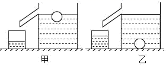

# Physics - 题目 347

**ID**: b4cc553e3e8442f5823a6456b2871dba
**年级**: Grade 8
**难度**: Hard
**题型**: Multiple-select

## 题目
如图所示，水平桌面上有两个完全相同的溢水杯，甲杯中装满水，乙杯中装满酒精。​​​​​​​‌将两个完全相同的小球分别放入溢水杯中，甲杯溢出0.9N的水，乙杯溢出0.8N的酒精。下列说法正确的是（酒精的密度为0.8×10^{3}kg/m^{3}，g取10N/kg）（      ）

## 解答

1. A．小球在甲杯中受浮力的作用，在乙杯中也受浮力的作用，故A错误；
2. BC．乙杯溢出0.8N的酒精，溢出酒精的质量
3. $m{{}_{排酒}}{\rm{=}}\frac {G{{}_{排酒}}}{g}{\rm{=}}\frac {0.8{\rm{N}}}{{\rm{1}}{\rm{0}}{\rm{N}}{\rm{/}}{\rm{k}}{\rm{g}}}=0.08{\rm{k}}{\rm{g}}=80{\rm{g}}$
4. 溢出酒精的体积
5. $V{{}_{排酒}}{\rm{=}}\frac {m{{}_{排酒}}}{ρ{{}_{酒}}}{\rm{=}}\frac {80{\rm{g}}}{0.8{\rm{g}}/{\rm{c}}{\rm{m}}{^{3}}}=100{\rm{c}}{\rm{m}}{^{3}}$
6. 因小球在乙杯中沉在容器底部，故可知
7. $V{{}_{球}}=V{{}_{排酒}}=100{\rm{c}}{\rm{m}}{^{3}}$
8. 小球在甲中漂浮，由漂浮的特点
9. $F{{}_{浮水}}{\rm{=}}G{{}_{球}}=m{{}_{球}}g$ ……①
10. 由阿基米德原理有
11. $F{{}_{浮水}}{\rm{=}}G{{}_{排水}}=m{{}_{排水}}g$ ……②
12. 由①②得
13. $m{{}_{球}}=m{{}_{排水}}=\frac {G{{}_{排水}}}{g}=\frac {0.9{\rm{N}}}{10{\rm{N}}/{\rm{k}}{\rm{g}}}=0.09{\rm{k}}{\rm{g}}=90{\rm{g}}$
14. 小球的密度为
15. $ρ{{}_{球}}=\frac {m{{}_{球}}}{V{{}_{球}}}=\frac {90{\rm{g}}}{100{\rm{c}}{\rm{m}}{^{3}}}=0.9{\rm{g}}{\rm{/}}{\rm{c}}{\rm{m}}{^{3}}=0.9\times 10{^{3}}{\rm{k}}{\rm{g}}{\rm{/}}{\rm{m}}{^{3}}$
16. 故BC正确；
17. D．ρ_{水}＞ρ_{酒精}，完全相同的溢水杯，溢水杯底部的深度相同，由p＝ρgh可知，液体对甲杯底的压强大于液体对乙杯底的强，故D正确。
18. 故选BCD。
19. 【点睛】
20. 本题考查了阿基米德原理、漂浮的特点、密度公式、重力公式及液体压强公式的应用，综合性较强，有一定难度。

## 知识点

**中文**:
  - 密度、压强和浮力的综合
  - 液体压强计算公式的应用
  - 阿基米德原理的应用
  - 物体的浮沉条件及其应用

**English**:
  - Integrated Density, Pressure, and Buoyancy
  - Application of Liquid Pressure Formula
  - Applications of Archimedes' Principle
  - Floating/Sinking Conditions and Applications

---
