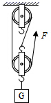

# Physics - 题目 586

**ID**: 26e89e235abc40f98f623cc157dc8b9b
**年级**: Grade 8
**难度**: Medium
**题型**: Calculation

## 题目
搬运工人用如图所示的滑轮组将一个重120N的物体匀速提升3m，所用的拉力为50N，不计绳重及摩擦．求：（1）滑轮组的机械效率；​​​​​​​‌（2）动滑轮的重；（3）若用该滑轮组同时拉4个这样的物体，拉力为多大．

## 解答

1. （1）由图可知，n=3，滑轮组的机械效率为
2. $η=\frac {G}{nF}\times 100\%=\frac {{\rm{1}}{\rm{2}}{\rm{0}}{\rm{N}}}{{\rm{3}}{\rm{×}}{\rm{5}}{\rm{0}}{\rm{N}}}\times 100\%=80\%$
3. （2）动滑轮的重
4. $G{{}_{{\rm{?}}{\rm{?}}{\rm{\;}}}}=nF-G{{}_{*{{}_{y}}}}=3\times 50{\rm{N}}{\rm{-}}{\rm{1}}{\rm{2}}{\rm{0}}{\rm{N}}{\rm{=}}{\rm{3}}{\rm{0}}{\rm{N}}$
5. （3）4个这样的物体总重为
6. $G{{}_{总}}=nG{{}_{物}}=4\times 120{\rm{N}}{\rm{=}}{\rm{4}}{\rm{8}}{\rm{0}}{\rm{N}}$
7. 故所用拉力的大小为
8. $F=\frac {1}{n}G{{}_{总}}-G{{}_{轮}}=\frac {1}{3}\times 480{\rm{N}}{\rm{-}}{\rm{3}}{\rm{0}}{\rm{N}}{\rm{=}}{\rm{1}}{\rm{3}}{\rm{0}}{\rm{N}}$

## 知识点

**中文**:
  - 滑轮组及其工作特点
  - 滑轮组绳子拉力的计算
  - 滑轮（组）的机械效率及其计算

**English**:
  - Pulley Systems and Operating Characteristics
  - Calculating Rope Tension in Pulley Systems
  - Mechanical Efficiency of Pulleys and Calculations

---
