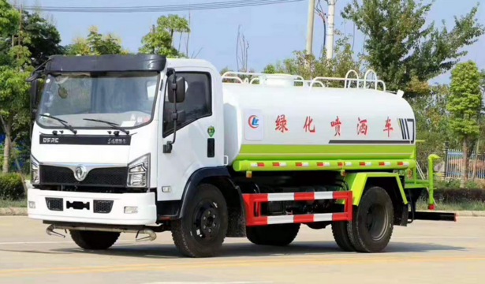

# Physics - 题目 2129

**ID**: 2ea64a71a4e24b99811f0403e17081ed
**年级**: Grade 8
**难度**: Medium
**题型**: Calculation

## 题目
如图所示是一辆停在水平路面上的洒水车，洒水车空车质量为 $6{\rm{t}}$ ，水罐最多能装 $5{\rm{t}}$ 的水，车轮与地面的总受力面积为 $0.5{\rm{m}}{^{2}}$ （g取 $10{{\rm{N}}}/{{\rm{k}}{\rm{g}}}$ ）。​​​​​​​‌（1）若罐内水深 $1.5{\rm{m}}$ ，则水对罐底的压强为多少?（2）洒水车装满水，求汽车静止在水平公路上时对地面的压强?（3）若洒水车对地面的压强为 $2\times 10{^{5}}{\rm{P}}{\rm{a}}$ ，则洒水车的总质量?

## 解答

1. （1）水对罐底压强 $p=ρgh=1.0\times 10{^{3}}{\rm{k}}{\rm{g}}{\rm{/}}{\rm{m}}{^{3}}\times 10{\rm{N}}{\rm{/}}{\rm{k}}{\rm{g}}\times 1.5{\rm{m}}=1.5\times 10{^{4}}{\rm{P}}{\rm{a}}$
2. （2）车和水的总质量为 $m{{}_{总}}=6{\rm{t}}+5{\rm{t}}{\rm{=}}{{1}}{{1}}{\rm{t}}=1.1\times 10{^{4}}{\rm{k}}{\rm{g}}$
3. 车对地面压力 $F=G{{}_{总}}=m{{}_{总}}g=1.1\times 10{^{4}}{\rm{k}}{\rm{g}}\times 10{\rm{N}}{\rm{/}}{\rm{k}}{\rm{g}}=1.1\times 10{^{5}}{\rm{N}}$
4. 车对地面压强 $p=\frac {F}{S}=\frac {1.1\times 10{^{5}}{\rm{N}}}{0.5{\rm{m}}{^{2}}}=2.2\times 10{^{5}}{\rm{P}}{\rm{a}}$
5. （3）洒水车的重力 $G=F^{′}=p^{′}S=2\times 10{^{5}}{\rm{P}}{\rm{a}}\times 0.5{\rm{m}}{^{2}}=1\times 10{^{5}}{\rm{N}}$
6. 洒水车的质量 $m{{}_{车}}=\frac {G}{g}=\frac {1\times 10{^{5}}{\rm{N}}}{10{\rm{N}}{\rm{/}}{\rm{k}}{\rm{g}}}=1\times 10{^{4}}{\rm{k}}{\rm{g}}$

## 知识点

**中文**:
  - 压强的计算
  - 重力公式的应用
  - 液体压强计算公式的应用

**English**:
  - Calculation of Pressure
  - Application of Gravity Formula
  - Application of Liquid Pressure Formula

---
