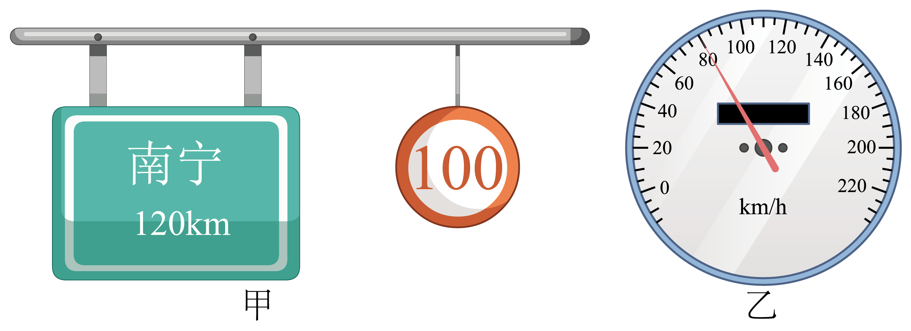

# Physics - 题目 689

**ID**: 34f339166a4146e7a9ea8324057ff10e
**年级**: Grade 8
**难度**: Medium
**题型**: Calculation

## 题目
小刚一家利用元旦假期到南宁玩，汽车在公路上行驶了一段时间，他看到了如图所示标志牌和汽车的速度计。​​​​​​​‌（1）在不违反交通规则的前提下，汽车在公路上行驶的最快速度是多少？（2）若汽车以最快的速度行驶，求从图甲的标志牌到南宁需要的时间。（3）若以图乙所示的速度行驶2.5h，求汽车通过的路程。

## 解答

1. （1）由图甲的限速标志牌可知，汽车在公路上行驶的最快速度为100km/h。
2. （2）图甲中“南宁120km”是指从此地到南宁的路程s=120km，从标志牌到南宁需要的时间为 $t=\frac {s}{v}=\frac {{\rm{1}}{\rm{2}}{\rm{0}}{\rm{k}}{\rm{m}}}{{\rm{1}}{\rm{0}}{\rm{0}}{\rm{k}}{\rm{m}}{\rm{/}}{\rm{h}}}{\rm{=}}{\rm{1}}{\rm{.}}{\rm{2}}{\rm{h}}$ 。
3. （3）图乙速度计所示的速度是80km/h，汽车行驶2.5h通过的路程为s′=v′t′=80km/h×2.5h=200km。
4. 答：（1）在不违反交通规则的前提下，汽车在公路上行驶的最快速度是100km/h；
5. （2）若汽车以最快的速度行驶，从图甲的标志牌到南宁需要的时间是1.2h；
6. （3）以图乙所示的速度行驶2.5h，汽车通过的路程是200km。

## 知识点

**中文**:
  - 速度的综合计算

**English**:
  - Comprehensive Velocity Calculations

---
