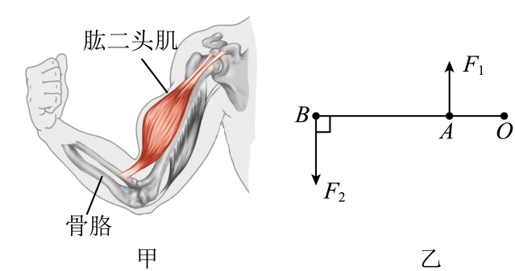

# Physics - 题目 2695

**ID**: 486df598579346418e37f27d5077ea5e
**年级**: Grade 8
**难度**: Medium
**题型**: Calculation

## 题目
图甲为小阳举着哑铃的前臂骨骼，可将其视为如图乙所示的杠杆。​​​​​​​‌不计前臂自重，小阳的肱二头肌能施加的最大拉力 ${\rm \mathit{F}\mathit{_{1}}=600N，}OA∶OB=1∶6$ ， 若小阳利用最大质量为m的哑铃进行锻炼，1min内可举起哑铃30次，每次将哑铃举高20cm。请完成以下问题：（1）前臂骨骼相当于一个杠杆，哑铃的重力（选填“是”或“不是”）作用在该杠杆上的阻力；（2）小阳平时锻炼时能举起哑铃的最大重力为多少？（3）小阳对哑铃做功的功率为多少？

## 解答

1. （1）在人体中，前臂骨骼在举起哑铃等重物时，起到了杠杆的作用。由于前臂的支点（即肘关节）到重物的距离（阻力臂）小于到前臂肌肉产生的力的距离（动力臂），因此前臂骨骼相当于一个费力杠杆。
2. 哑铃的重力作用在哑铃上，没有作用在该杠杆上，不是该杠杆上的阻力。
3. （2）已知小阳的肱二头肌能施加的最大拉力 ${\rm \mathit{F}\mathit{_{1}}=600N，}OA:OB=1:6$ ，根据杠杆平衡条件可得 $F{{}_{1}}\times OA=G\times OB$ ，代入数据解得 $G=\frac {F{{}_{1}}\times OA}{OB}=600{\rm{N}}\times \frac {1}{6}=100{\rm{N}}$ 。
4. （3）小阳平时锻炼时能举起哑铃的最大质量 $m=\frac {G}{g}=\frac {100Ν}{10Ν/{\rm{k}}{\rm{g}}}=10{\rm{k}}{\rm{g}}$ ，小阳1min内对哑铃所做的功 $W=nGh=30\times 100{\rm{N}}\times 0.2{\rm{m}}=600{\rm{J}}$ ，小阳对哑铃做功的功率 $P=\frac {W}{t}=\frac {600{\rm{J}}}{60{\rm{s}}}=10{\rm{W}}$ 。

## 知识点

**中文**:
  - 功率的计算和估算
  - 功的计算和估算
  - 杠杆平衡条件的应用
  - 杠杆的分类

**English**:
  - Calculation and Estimation of Power
  - Calculation and Estimation of Work
  - Application of Lever Equilibrium Conditions
  - Classification of Levers

---
