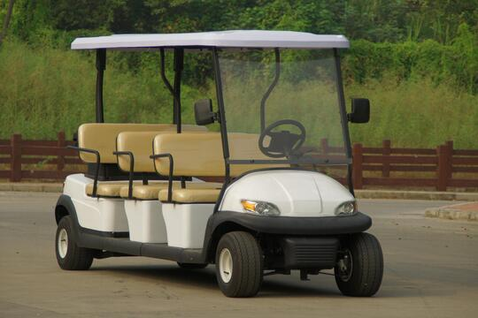

# Physics - 题目 1771

**ID**: 6037e2395c7e4e6a933552406b17ca25
**年级**: Grade 8
**难度**: Medium
**题型**: Calculation

## 题目
如图所示的电动观光车，有关技术参数如下表。​​​​​​​‌g取 $10{\rm{N}}{\rm{/}}{\rm{k}}{\rm{g}}$ ，根据技术参数，求解下列问题：空车质量 ${{1}}{{1}}{{8}}{{0}}{\rm{k}}{\rm{g}}$人员平均质量为 ${{6}}{{0}}{\rm{k}}{\rm{g}}$满载10人满载时发动机功率 ${{4}}{\rm{k}}{\rm{W}}$（1）空车受到的重力是多大？（2）满载时，行车 ${{1}}{\rm{m}}{\rm{i}}{\rm{n}}$ 发动机做功为多少焦？（3）满载时，观光车在某段平直路面上， ${{1}}{\rm{m}}{\rm{i}}{\rm{n}}$ 匀速行驶 ${{6}}{{0}}{{0}}{\rm{m}}$ ，受阻力为总重的0.02倍，求牵引力做的有用功为多大？

## 解答

1. 解：（1）空车受到的重力是G_{车}=m_{车}g=1180kg×10N/kg=1.18×10^{4}N
2. （2）在满载时，行车1min电动机做的功为W_{总}=Pt=4000W×60s=2.4×10^{5}J
3. （3）人的总重为G_{人}=m_{人}g=10×60kg×10N/kg=6×10^{3}N
4. 满载时车和人的总重为G_{总}=G_{车}+G_{人}=1.18×10^{4}N+6×10^{3}N=1.78×10^{4}N
5. 匀速直线运动时的牵引力为F=f=0.02G_{总}=0.02×1.78×10^{4}N =356N
6. 牵引力做的有用功为W_{有}=FS=356N×600m=2.136×10^{5}J
7. 答：（1）空车受到的重力是 $1.18\times 10{^{4}}{\rm{N}}$ ；
8. （2）行车1min发动机做功为 $2.4\times 10{^{5}}{\rm{J}}$ ；
9. （3）牵引力做的有用功为 $2.136\times 10{^{5}}{\rm{J}}$ 。

## 知识点

**中文**:
  - 有用功、额外功和总功的计算
  - 重力公式的应用

**English**:
  - Calculation of Useful, Extra, and Total Work
  - Application of Gravity Formula

---
