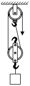

# Physics - 题目 1052

**ID**: 66913d92bd7141649e5b8023d243d7f2
**年级**: Grade 8
**难度**: Medium
**题型**: Calculation

## 题目
用如图所示的滑轮组提升重物，物体重为150N，拉动物体匀速上升2m，所用的时间是5s，拉力做的功是400J，求：（1）提升过程中拉力的大小；（2）提升装置做的有用功；（3）滑轮组的机械效率。​​​​​​​‌

## 解答

1. 解：（1）由图可知，滑轮组绳子的有效股数n=2，则绳子自由端移动的距离
2. s=nh=2×2m=4m
3. 由W=Fs可得，提升过程中拉力的大小
4. F= $\frac {W{{}_{总}}}{s}$ = $\frac {400{\rm{J}}}{4{\rm{m}}}$ =100N
5. （2）提升装置做的有用功
6. W_{有}=Gh=150N×2m=300J
7. （3）滑轮组的机械效率
8. η= $\frac {W{{}_{有}}}{W{{}_{总}}}$ ×100%= $\frac {300{\rm{J}}}{400{\rm{J}}}$ ×100%=75%
9. 答：（1）提升过程中拉力的大小为100N；
10. （2）提升装置做的有用功为300J；
11. （3）滑轮组的机械效率为75%。

## 知识点

**中文**:
  - 有用功、额外功和总功的计算
  - 滑轮组绳子拉力的计算
  - 滑轮（组）的机械效率及其计算

**English**:
  - Calculation of Useful, Extra, and Total Work
  - Calculating Rope Tension in Pulley Systems
  - Mechanical Efficiency of Pulleys and Calculations

---
