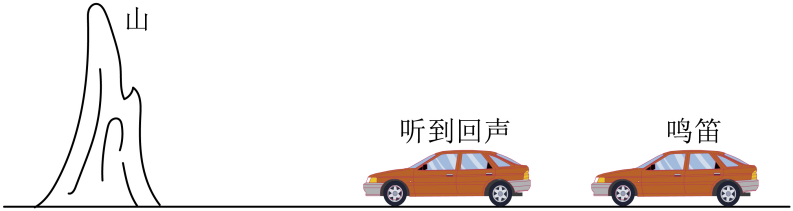

# Physics - 题目 111

**ID**: 9d8dbaf572124afbba9d59d0fc4597c3
**年级**: Grade 8
**难度**: Medium
**题型**: Calculation

## 题目
如图所示，一辆汽车以72km/h的速度匀速驶向正前方的山崖，鸣笛3s后听到回声，已知声音在空气中的传播速度为340m/s，请问：（1）3s内声音传播的距离是多少？（2）3s内汽车行驶的路程是多少？（3）汽车听到回声时到山崖的距离是多少？​​​​​​​‌

## 解答

1. （1）由 $v=\frac {s}{t}$ 可得，鸣笛声从发出到听到回声这段时间内通过的路程s_{2}=v_{2}t_{2}=340m/s×3s=1020m。
2. （2）已知汽车速度v_{1}=72km/h=20m/s，由 $v=\frac {s}{t}$ 可得，3s内汽车行驶的路程s_{1}=v_{1}t_{1}=20m/s×3s=60m。
3. （3）听到回声时车离山崖距离 $s=\frac {s{{}_{2}}-s{{}_{1}}}{2}=\frac {1020{\rm{m}}-60{\rm{m}}}{2}=480{\rm{m}}$ 。

## 知识点

**中文**:
  - 回声测距离的应用

**English**:
  - Distance Measurement using Echo

---
