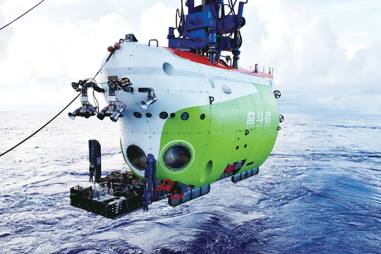

# Physics - 题目 2495

**ID**: a80cf1e45d3940abae9e809515cda748
**年级**: Grade 8
**难度**: Medium
**题型**: Calculation

## 题目
如图所示，2020年11月10日8时12分，我国“奋斗者”号载人潜水器，坐底马里亚纳海沟，其下潜的速度为20m/s，从接触水面开始计时，51s时向海底发射一束超声波，13s后收到信息，（超声波在海水中的速度是1500m/s），求：（1）从发射超声波到13s后收到信息，超声波传播的路程；（2）从发射超声波到13s后收到信息，“奋斗者”号下潜的深度；（3）收到信息时，“奋斗者”号距海底的距离；（4）此海域的深度。​​​​​​​‌

## 解答

1. 解：（1）由 $v=\frac {s}{t}$  可得，从发射超声波到13s后收到信息，超声波传播的路程
2. s_{1}=v_{声}t=1500m/s×13s=19500m
3. （2）由 $v=\frac {s}{t}$  可得，从发射超声波到13s后收到信息，“奋斗者”号下潜的深度
4. s_{2}=v_{奋}_{斗者}t=20m/s×13s=260m
5. （3）收到信息时，“奋斗者”号距海底的距离
6. $s=\frac {1}{2}(s{{}_{1}}-s{{}_{2}})=\frac {1}{2}(19500{\rm{m}}-260{\rm{m}})=9620{\rm{m}}$
7. （4）由 $v=\frac {s}{t}$  可知，收到信息时，潜水器下潜所用的时间
8. t′=t+t_{0}=13s+51s=64s
9. 下潜的深度
10. s′=v_{奋}_{斗者}t′=20m/s×64s=1280m
11. 海域的深度
12. h=s+s′=9620m+1280m=10900m
13. 答：（1）从发射超声波到13s后收到信息，超声波传播的路程为19500m；
14. （2）从发射超声波到13s后收到信息，“奋斗者”号下潜的深度为260m；
15. （3）收到信息时，“奋斗者”号距海底的距离为9620m；
16. （4）此海域的深度为10900m。

## 知识点

**中文**:
  - 回声测距离的应用
  - 速度公式及其应用

**English**:
  - Distance Measurement using Echo
  - Velocity Formula and Applications

---
