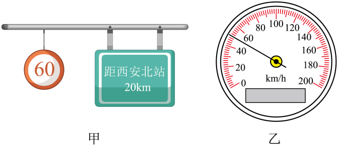

# Physics - 题目 2020

**ID**: d1e54af21fb344ed9094aae04141110d
**年级**: Grade 8
**难度**: Medium
**题型**: Calculation

## 题目
小亮爸爸开车送小亮和妈妈去西安北站乘坐高铁前往上海游玩，汽车行驶途中小亮看到路旁的交通标志牌如图甲所示，汽车的速度表如图乙所示，小亮和妈妈所坐列车的部分运行信息如下表。​​​​​​​‌求：车次发车时间到达时间路程G4918西安北（19︰25）上海虹桥（23︰55）892.4km（1）按汽车速度表的速度匀速行驶，汽车从标志牌到西安北站的行驶时间是多少min？（2）G4918次列车从西安北到上海虹桥运行的平均速度是多少km/h？（结果保留整数）（3）若在列车行驶途中，以全程的平均速度完全通过长为1220m的隧道，用时36s，则该列车的长度是多少？

## 解答

1. 解：（1）汽车速度表上标注的速度为50km/h，汽车从标志牌到西安北站的行驶时间 $v=\frac {s}{t}{\rm{=}}\frac {20{\rm{k}}{\rm{m}}}{{{5}}{{0}}{\rm{k}}{\rm{m}}{\rm{/}}{\rm{h}}}{\rm{=}}0.4{\rm{h}}{\rm{=}}0.4\times 60{\rm \min }{\rm{=}}24{\rm \min }$ 。
2. （2）G4918次列车从西安北到上海虹桥运行的平均速度 $t{{}_{1}}{\rm{=}}23︰55-19︰{{2}}5{\rm{=}}4︰30{\rm{=}}4.5{\rm{h}}$ ， $v^{′}=\frac {s^{′}}{t{{}_{1}}}{\rm{=}}\frac {892.4{\rm{k}}{\rm{m}}}{4.5{\rm{h}}}\approx 198{\rm{k}}{\rm{m}}{\rm{/}}{\rm{h}}$ 。
3. （3）该列车的长度 $s^{′′}=v^{′}t^{′′}-s{{}_{隧道}}{\rm{=}}\frac {198}{3.6}{\rm{m}}{\rm{/}}{\rm{s}}\times 36{\rm{s}}-1220{\rm{m}}{\rm{=}}760{\rm{m}}$ 。
4. 答：（1）按汽车速度表的速度匀速行驶，汽车从标志牌到西安北站的行驶时间是24min；
5. （2）G4918次列车从西安北到上海虹桥运行的平均速度是198km/h；
6. （3）该列车的长度是760m。

## 知识点

**中文**:
  - 速度的综合计算

**English**:
  - Comprehensive Velocity Calculations

---
