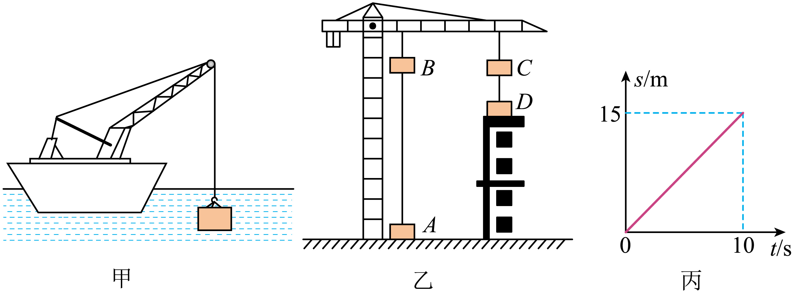

# Physics - 题目 289

**ID**: d616718749964c429d77f4f3bde391b5
**年级**: Grade 8
**难度**: Medium
**题型**: Calculation

## 题目
某港口有一体积为 $1{\rm{m}}{^{3}}$ ，重力为 $2\times 10{^{4}}{\rm{N}}$ 的密封货箱不慎落入江中，打捞上货箱后，吊机在陆地上用绳子将货箱从 $\mathrm{A}$ 处匀速向上提升到高为60m的 $B$ 处，然后水平移动30m到 $C$ 处，最后竖直下放到指定位置 $D$ ， $CD$ 段路程随时间变化图像如丙图所示，在此过程中，求：（ $g$ 取 $10{\rm{N}}/{\rm{k}}{\rm{g}}$ ， $ρ{{}_{水}}=1\times 10{^{3}}{\rm{k}}{\rm{g}}/{\rm{m}}{^{3}}$ ）。​​​​​​​‌（1）如图甲所示为打捞过程中某时刻，货箱浸没在水中保持静止，求货箱此刻受到水的浮力和绳子的拉力；（2） $BC$ 段吊机对货箱的拉力做的功；（3） $CD$ 段货箱所受重力做功的功率。

## 解答

1. （1）据甲图可知，货箱完全浸没在水中，则受到的浮力为 $F{{}_{浮}}=ρ{{}_{液}}gV{{}_{排}}=1.0\times 10{^{3}}kg/{\rm{m}}{^{3}}\times 10{\rm{N}}/kg\times 1{\rm{m}}{^{3}}=10{^{4}}{\rm{N}}$
2. 货箱处于静止状态，根据平衡力可知，绳子的拉力为 $F=G-F{{}_{浮}}=2\times 10{^{4}}{\rm{N}}-1\times 10{^{4}}{\rm{N}}=1\times 10{^{4}}{\rm{N}}$
3. （2）吊机对货箱的拉力是竖直向上的，运动的距离是水平方向的，此时力与距离垂直，因此吊机对货箱的拉力做的功为0J。
4. （3）据丙图可知，货箱运动的速度为 $v=\frac {s}{t}=\frac {15{\rm{m}}}{10{\rm{s}}}=1.5{\rm{m}}/{\rm{s}}$
5. $CD$ 段货箱所受重力做功的功率为 $P=Gv=2\times 10{^{4}}{\rm{N}}\times 1.5{\rm{m}}/{\rm{s}}=3\times 10{^{4}}{\rm{W}}$

## 知识点

**中文**:
  - 二力及多力平衡的判断和应用
  - 阿基米德原理的应用
  - 功的计算和估算
  - 功率的计算和估算

**English**:
  - Judgment and Application of Equilibrium of Forces
  - Applications of Archimedes' Principle
  - Calculation and Estimation of Work
  - Calculation and Estimation of Power

---
