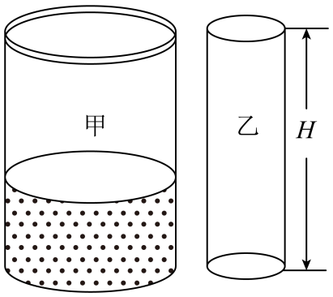

# Physics - 题目 2890

**ID**: d91e09cfb2f042ff97fb9f8105574974
**年级**: Grade 8
**难度**: Medium
**题型**: Calculation

## 题目
如图所示，装有水的薄壁轻质圆柱形容器甲与圆柱形物块乙等高，放置于水平地面上，甲中水的深度为0.1米，底面积为0.02米^{2}，求：（1）水对容器底部的压强p_{水}。​​​​​​​‌（2）容器内水的质量m_{水}。（3）若水的深度是容器高度的 $\frac {1}{3}$ ，甲的底面积是乙的2倍，乙的密度是水的3倍，现将乙放入容器甲中，求：水对容器底的压强与容器对地面的压强的比值。

## 解答

1. 解：（1）由题意可知，甲中水的深度为h=0.1m，故可知水对容器底部的压强为
2. p_{水}=ρ水gh=1×10^{3}kg/m^{3}×9.8N/kg×0.1m=980Pa
3. （2）由题意可知，甲中水的深度为h=0.1m，甲的底面积为S_{甲}=0.02m^{2}，故可知甲中水的体积为
4. V_{水}=S_{甲}h=0.02m^{2}×0.1m=2×10^{-3}m^{3}
5. 故容器内水的质量为
6. m_{水}=ρ水V水=ρ_{水}S_{甲}h=1×10^{3}kg/m^{3}×2×10^{-3}m^{3}=2kg
7. （3）由题意可知，乙的密度大于水的密度，故将乙放入容器甲后，乙的底部将与甲的底部相接触，设甲的底面积为S_{甲}，乙的底面积为S_{乙}，由题意可知，乙圆柱体的体积为
8. V_{乙}=S_{乙}h_{乙}=0.01m^{2}×0.3m=3×10^{-3}m^{3}
9. 甲容器中剩余部分的体积为
10. V_{剩}=V_{甲}-V_{水}=0.02m^{2}×0.3m-2×10^{-3}m^{3}=4×10^{-3}m^{3}
11. 可知甲容器中剩余部分的体积大于乙圆柱体的体积，故将乙放入甲后，水不会溢出，因将甲放入乙前后，水的体积V水保持不变，设放入乙后甲容器中水的高度为h′_{水}，则有
12. S_{甲}h_{水}=(S_{甲}-S_{乙})h^{′}_{水}
13. 由题意可知
14. S_{甲}=2S_{乙}
15. 故解得
16. h^{’}_{水}=2h_{水}
17. 由受力分析可知，此时容器对地面的压力等于水与圆柱体乙的重力之和，故水对容器底的压强与容器对地面的压强的比值为
18. $\frac {p{{}_{水}}}{p{{}_{容}}}=\frac {ρ{{}_{水}}gh{{}_{水}^{\prime }}}{\frac {G{{}_{水}}+G{{}_{乙}}}{S{{}_{甲}}}}=\frac {ρ{{}_{水}}gh{{}_{水}^{\prime }}}{\frac {ρ{{}_{水}}gS{{}_{甲}}h{{}_{水}}{\rm{+}}ρ{{}_{乙}}gS{{}_{乙}}3h{{}_{水}}}{S{{}_{甲}}}}$
19. 将S_{甲}=2S_{乙}、ρ_{乙}=3ρ_{甲}、h′_{水}=2h_{水}代入解得
20. $\frac {p{{}_{水}}}{p{{}_{容}}}=\frac {4}{11}$
21. 答：（1）水对容器底部的压强p_{水}为980Pa；
22. （2）容器内水的质量m_{水}为2kg；
23. （3）水对容器底的压强与容器对地面的压强的比值为4∶11。

## 知识点

**中文**:
  - 压强的计算
  - 密度公式的应用
  - 液体压强的大小及其计算

**English**:
  - Calculation of Pressure
  - Application of Density Formula
  - Magnitude and Calculation of Liquid Pressure

---
