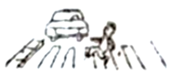

# Physics - 题目 2881

**ID**: f3302fd62d2848249c0e7c9cb005e440
**年级**: Grade 8
**难度**: Medium
**题型**: Calculation

## 题目
如图所示，小明想横穿一条18m宽的人行道，他的步行速度为1.5m/s。​​​​​​​‌求：（1）小明横穿人行道需多长时间?（2）若一辆汽车从道路右边行驶过来，速度为36km/h，为了安全横穿马路，并且要求预留10s的安全时间，横穿前小明至少要离行驶过来的汽车多远，才能保证安全?

## 解答

1. (1)根据v= $\frac {s}{t}$ 可得，小明横穿人行道所需的时间：
2. t= $\frac {s}{v}$ = $\frac {18{\rm{m}}}{1.5{\rm{m}}/{\rm{s}}}$ =12s；
3. (2)汽车的速度v′＝36km/h＝10m/s，由题意可知，汽车行驶的时间：
4. t′＝12s＋10s＝22s，
5. 横穿前小明至少要离行驶过来的汽车距离：
6. s′＝v′t′＝10m/s×22s＝220m。
7. 答：(1)小明横穿道路的时间要12s；
8. (2)横穿前至少要离行驶过来的汽车距离220m。

## 知识点

**中文**:
  - 速度公式及其应用

**English**:
  - Velocity Formula and Applications

---
