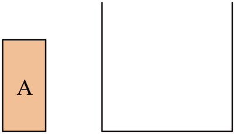

# Physics - 题目 15

**ID**: fa0655fd695b475488f2da49a3783bd5
**年级**: Grade 8
**难度**: Medium
**题型**: Calculation

## 题目
如图所示，A是高10cm、底面积为40cm^{2}的长方体金属块 $(ρ{{}_{金}}=2.0{\rm g}/{\rm cm}{^{3}})$ ，有一质量为100g、底面积为100cm^{2}、高为8cm的柱形水杯，注入6cm深的水，都置于水平地面上；将A截取部分从接触水面开始，竖直缓慢放入水中。​​​​​​​‌求：（1）截取前金属块A的重力；（2）竖直截取A的一半并竖直浸入水中，水对容器底的压强；（3）水平截取A，当截取部分下移4cm时刚好浸没，轻轻松手，水面稳定后容器对桌面的压强。

## 解答

1. （1）由题意可知，未截去前金属块A的体积 $V{{}_{{\rm{A}}}}{\rm{=}}S{{}_{{\rm{A}}}}h{{}_{{\rm{A}}}}{\rm{=}}{{4}}{{0}}{\rm{c}}{\rm{m}}{^{2}}\times 10{\rm{c}}{\rm{m}}{\rm{=}}400{\rm{c}}{\rm{m}}{^{3}}$ ，根据 $ρ{\rm{=}}\frac {m}{V}$ 可得，金属块A的质量 $m{{}_{{\rm{A}}}}{\rm{=}}ρ{{}_{金}}V{{}_{{\rm{A}}}}{\rm{=}}2.0{\rm{g}}{\rm{/}}{\rm{c}}{\rm{m}}{^{3}}\times 400{\rm{c}}{\rm{m}}{^{3}}{\rm{=}}{{8}}{{0}}{{0}}{\rm{g}}{\rm{=}}0.8{\rm{k}}{\rm{g}}$ ，由G=mg可得，截取前金属块A的重力 $G{{}_{{\rm{A}}}}{\rm{=}}m{{}_{{\rm{A}}}}g{\rm{=}}{{0}}{{.}}{{8}}{\rm{k}}{\rm{g}}\times {{1}}{{0}}{\rm{N}}{\rm{/}}{\rm{k}}{\rm{g}}{\rm{=}}{{8}}{\rm{N}}$
2. （2））竖直截取A的一半后，截去的部分的底面积 $S{{}_{{\rm{A}}}^{′}}{\rm{=}}\frac {1}{2}S{{}_{{\rm{A}}}}{\rm{=}}\frac {1}{2}\times {{4}}{{0}}{\rm{c}}{\rm{m}}{^{2}}{\rm{=}}{{2}}{{0}}{\rm{c}}{\rm{m}}{^{2}}{\rm ，B}$ 容器中水的体积 $V{{}_{水}}{\rm{=}}S{{}_{容}}h{{}_{水}}{\rm{=}}100{\rm{c}}{\rm{m}}{^{2}}\times 6{\rm{c}}{\rm{m}}{\rm{=}}600{\rm{c}}{\rm{m}}{^{3}}$ ，将截去部分竖直放入水中，设此时水面的高度为h_{1}，则可知此时水的体积 $V{{}_{水}}{\rm{=}}{\rm{(}}S{{}_{容}}{{-}}S{{}_{{\rm{A}}}^{′}}{\rm{)}}h{{}_{{{1}}}}$ ，因放入截去部分后，容器中的水的体积不变，故可得放入截去部分后，水面的高度 $h{{}_{{{1}}}}{\rm{=}}\frac {V{{}_{水}}}{S{{}_{容}}{{-}}S{{}_{{\rm{A}}}^{′}}}{\rm{=}}\frac {600{\rm{c}}{\rm{m}}{^{3}}}{100{\rm{c}}{\rm{m}}{^{2}}{{-}}20{\rm{c}}{\rm{m}}{^{2}}}{\rm{=}}7.5{\rm{c}}{\rm{m}}$ ，因容器的高度为8cm，故可知此时水未溢出，最终水对容器底的压强 $p{{}_{水}}{\rm{=}}ρ{{}_{水}}gh{{}_{{{1}}}}{\rm{=}}{{1}}\times {{1}}{{0}}{^{{{3}}}}{\rm{k}}{\rm{g}}{\rm{/}}{\rm{m}}{^{{{3}}}}\times 10{\rm{N}}{\rm{/}}{\rm{k}}{\rm{g}}\times 7.5\times {{1}}{{0}}{^{{{-}}{{2}}}}{\rm{m}}{\rm{=}}750{\rm{P}}{\rm{a}}$
3. （3）水平截取A，当截取部分下移4cm时刚好浸没，假设截取部分的高度为h_{2}，水杯中的水没有溢出，如图所示
4. 
5. 可得，A截取部分的体积为 $V{{}_{{\rm{A}}}^{′}}{\rm{=}}S{{}_{容}}(h{{}_{2}}{{-}}4{\rm{c}}{\rm{m}}){\rm{=}}S{{}_{{\rm{A}}}}h{{}_{{{2}}}}$ ，代入数据可得 $100{\rm{c}}{\rm{m}}{^{2}}\times h{{}_{2}}{{-}}100{\rm{c}}{\rm{m}}{^{2}}\times 4{\rm{c}}{\rm{m}}{\rm{=}}40{\rm{c}}{\rm{m}}{^{2}}\times h{{}_{2}}$ ，解得 $h{{}_{2}}{\rm{=}}\frac {20}{3}{\rm{c}}{\rm{m}}$ ，水面上升的高度 $\frac {20}{3}{\rm{c}}{\rm{m}}{{-}}4{\rm{c}}{\rm{m}}{\rm{=}}\frac {8}{3}{\rm{c}}{\rm{m}}{\rm{>}}{\rm{(}}{{8}}{\rm{c}}{\rm{m}}{{-}}6{\rm{c}}{\rm{m}}{\rm{)}}{\rm{=}}{{2}}{\rm{c}}{\rm{m}}$ ，即大于水杯原来水面到杯口的距离，可知当截取部分下移4cm时刚好浸没时，杯中的水已有部分水溢出，此时A的截取部分刚好完全浸没在水中，且水面与杯口相平，如图所示
6. 
7. 则截取部分A的高度 $h{{}_{2}^{′}}{\rm{=}}8{\rm{c}}{\rm{m}}{{-}}2{\rm{c}}{\rm{m}}{\rm{=}}6{\rm{c}}{\rm{m}}$ ，截取A部分的体积 $V{{}_{{\rm{A}}{{1}}}}{\rm{=}}S{{}_{{\rm{A}}}}h{{}_{2}^{′}}{\rm{=}}40{\rm{c}}{\rm{m}}{^{2}}\times 6{\rm{c}}{\rm{m}}{\rm{=}}240{\rm{c}}{\rm{m}}{^{3}}$ ，截取A部分的质量 $m{{}_{{\rm{A}}{{1}}}}{\rm{=}}ρ{{}_{金}}V{{}_{{\rm{A}}{{1}}}}{\rm{=}}{{2}}{\rm{g}}{\rm{/}}{\rm{c}}{\rm{m}}{^{3}}\times 240{\rm{c}}{\rm{m}}{^{3}}{\rm{=}}480{\rm{g}}{\rm{=}}0.48{\rm{k}}{\rm{g}}$ ，截取A部分的重力为 $G{{}_{{\rm{A}}{{1}}}}{\rm{=}}m{{}_{{\rm{A}}{{1}}}}g{\rm{=}}{{0}}{{.}}{{4}}{{8}}{\rm{k}}{\rm{g}}\times {{1}}{{0}}{\rm{N}}{\rm{/}}{\rm{k}}{\rm{g}}{\rm{=}}{{4}}{{.}}{{8}}{\rm{N}}$ ，溢出水的体积 $V{{}_{溢}}{\rm{=}}V{{}_{{\rm{A}}{{1}}}}{{-}}S{{}_{容}}\times 2{\rm{c}}{\rm{m}}{\rm{=}}240{\rm{c}}{\rm{m}}{^{3}}{{-}}100{\rm{c}}{\rm{m}}{^{2}}\times 2{\rm{c}}{\rm{m}}{\rm{=}}40{\rm{c}}{\rm{m}}{^{3}}$ ，溢出水的质量 $m{{}_{溢}}{\rm{=}}ρ{{}_{水}}V{{}_{溢}}{\rm{=}}{{1}}{\rm{g}}{\rm{/}}{\rm{c}}{\rm{m}}{^{3}}\times 40{\rm{c}}{\rm{m}}{^{3}}{\rm{=}}40{\rm{g}}$ ，杯中剩余水的质量 $m{{}_{剩}}{\rm{=}}{{1}}{{0}}{{0}}{\rm{c}}{\rm{m}}{^{2}}\times 6{\rm{c}}{\rm{m}}\times 1{\rm{g}}{\rm{/}}{\rm{c}}{\rm{m}}{^{3}}{{-}}40{\rm{g}}{\rm{=}}{{5}}{{6}}{{0}}{\rm{g}}$ ，剩余水的重力 $G{{}_{剩}}{\rm{=}}m{{}_{剩}}g{\rm{=}}{{5}}{{6}}{{0}}\times {{1}}{{0}}{^{{{-}}{{3}}}}{\rm{k}}{\rm{g}}\times {{1}}{{0}}{\rm{N}}{\rm{/}}{\rm{k}}{\rm{g}}{\rm{=}}{{5}}{{.}}{{6}}{\rm{N}}$ ，水杯的重力 $G{{}_{杯}}{\rm{=}}m{{}_{杯}}g{\rm{=}}{{1}}{{0}}{{0}}\times {{1}}{{0}}{^{{{-}}{{3}}}}{\rm{k}}{\rm{g}}\times {{1}}{{0}}{\rm{N}}{\rm{/}}{\rm{k}}{\rm{g}}{\rm{=}}{{1}}{\rm{N}}$ ，轻轻松手，由于A的密度大于水的密度，所以截取A部分最终会沉到杯底，此时水面稳定后容器对桌面的压力 $F{{}_{压}}{\rm{=}}G{{}_{杯}}+G{{}_{剩}}+G{{}_{{\rm{A}}{{1}}}}{\rm{=}}1{\rm{N}}+5.6{\rm{N}}+4.8{\rm{N}}{\rm{=}}11.4{\rm{N}}$ ，根据 $p{\rm{=}}\frac {F}{S}$ 可得，容器对桌面的压强 $p{\rm{=}}\frac {F{{}_{{\rm{压}}}}}{S}{\rm{=}}\frac {{{1}}{{1}}{{.}}{{4}}{\rm{N}}}{{{1}}{{0}}{{0}}\times {{1}}{{0}}{^{{{-}}{{4}}}}{\rm{m}}{^{{{2}}}}}{\rm{=}}1140{\rm{P}}{\rm{a}}$

## 知识点

**中文**:
  - 密度、压强和浮力的综合

**English**:
  - Integrated Density, Pressure, and Buoyancy

---
