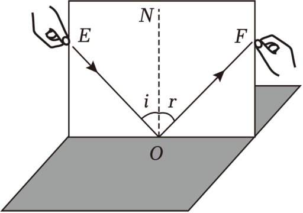

# Physics - 题目 1165

**ID**: 2835dea81411428485f7dfd431f7dc1f
**年级**: Grade 8
**难度**: Medium
**题型**: Comprehensive

## 题目
为了探究光反射时的规律，实验小组的同学选用了平面镜、纸板和激光器进行了如图所示的实验：（1）实验中还需要的测量器材是：；（2）实验中纸板的作用是：；（3）实验时，若入射角变大，则反射角将；（填“变大”“变小”或“不变”）（4）实验中将右侧纸板向后折，在右侧纸板上（填“能”“不能”）看到光线，本操作的目的是：；（5）实验小组的同学想到，从平面镜中能看到其他同学的眼睛时，其他同学也会看到自己的眼睛，说明的物理道理是：。​​​​​​​‌

## 解答

1. （1）实验中比较入射角和反射角的大小，还需要的测量器材是：量角器；
2. （2）实验中纸板的作用是：显示光路；
3. （3）反射角等于入射角，实验时，若入射角变大，则反射角将变大；
4. （4）实验中将右侧纸板向后折，则两个纸板不在同一平面内，在右侧纸板上不能看到光线，本操作的目的是：验证反射光线、入射光线和法线在同一平面内；
5. （5）实验小组的同学想到，从平面镜中能看到其他同学的眼睛时，其他同学也会看到自己的眼睛，说明的物理道理是在反射现象中，光路是可逆的。

## 知识点

**中文**:
  - 探究光的反射定律

**English**:
  - Investigation: Law of Reflection

---
