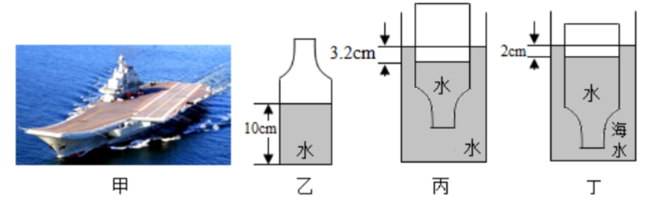

# Physics - 题目 1448

**ID**: a20655ff86a545cf8796604f77008ea9
**年级**: Grade 8
**难度**: Medium
**题型**: Comprehensive

## 题目
阅读短文，回答问题；如图甲所示，2021年5月国产第二艘航母“山东舰”已服役10个月了，航母搭载的舰载机质量为5150kg，舰载飞机与甲板的总接触面积为5000cm^{2}。​​​​​​​‌飞机的推重比是指飞机发动机所产生的总推力与飞机总重量的比值。该舰载机以720km/h速度飞行时的推重比为1.2。（1）下列说法中错误的是。

## 解答

1. （1）A．航母自身重，吃水深度大，还要抗打击，耐腐蚀，因此其材料要求用硬高大的特种钢材制成；故A正确，不符合题意；
2. B．航母静止在海面上受到浮力和重力的作用，它们是一对平衡对，故B正确，不符合题意；
3. C．惯性是物体的属性，其大小只与物体的质量有关，与速度无关，舰载机加速起飞过程中，惯性将不变；故C正确，不符合题意；
4. D．航母从江面航行到海面，所受的浮力不变，海水的密度大于江水，由 $V{{}_{排}}=\frac {F{{}_{浮}}}{ρ{{}_{液}}g}$ 可得，航母在海中排开海水的体积比江水少，航母将上浮一些。故D错误，符合题意。
5. （2）海上刮西风，向应调整为向西行驶，飞机迎风起飞，机翼上面空气流速会更大，压强更小，更有利于飞机起飞。
6. 惯性的大小和质量有关，飞机质量较大，因此惯性较大，降落到甲板后，受到阻拦索的阻挡而减速。
7. （3）需要的时间
8. $t=\frac {s}{v}=\frac {1080{\rm{k}}{\rm{m}}}{720{\rm{k}}{\rm{m}}{\rm{/}}{\rm{h}}}$ =1.5h
9. 由题可知，舰载机以720km/h速度飞行时的推重比为1.2。可得推力
10. F_{推}=1.2G=1.2mg=1.2×5150kg×10N/kg=61800N
11. 发动机推力的功率为
12. P= $\frac {W}{t}=\frac {F{{}_{推}}s}{t}$ =F_{推}v=61800N× $\frac {720}{3.6}$ m/s=1.236×10^{7}W
13. （4）设杯子的底面积为S，杯子在水中和在海水中受的浮力相等
14. F_{浮水}=F_{浮海水}
15. ρ_{水}gV_{排}=ρ_{海水}gV_{排}′
16. ρ_{水}g(V_{水}+Sh_{2})=ρ_{海水}g(V_{水}+Sh_{3})
17. 因为水的体积V_{水}=Sh_{1}，图中h_{1}=0.10m，h_{2}=0.032m，h_{3}=0.02m，解得ρ_{液}=1.1×10^{3}kg/m^{3}。

## 知识点

**中文**:
  - 二力及多力平衡的判断和应用
  - 流体压强与流速的关系
  - 阿基米德原理的应用
  - 功率的计算和估算

**English**:
  - Judgment and Application of Equilibrium of Forces
  - Relationship between Fluid Pressure and Flow Speed
  - Applications of Archimedes' Principle
  - Calculation and Estimation of Power

---
